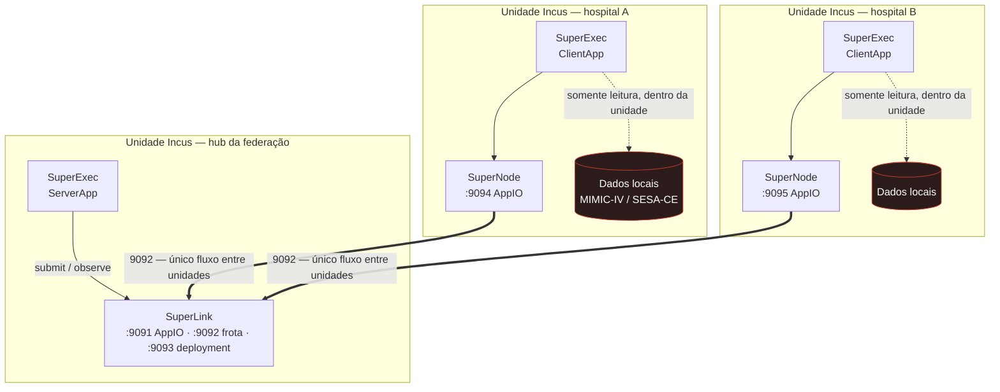
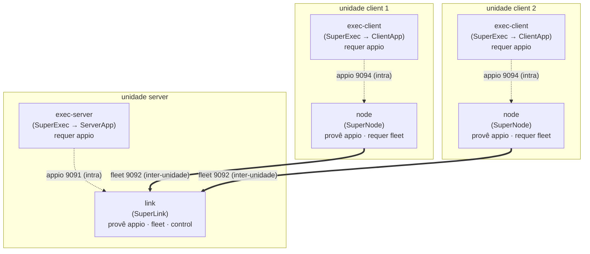
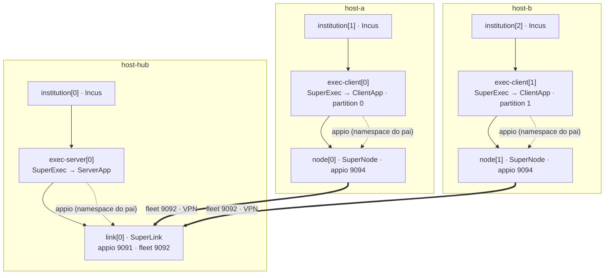
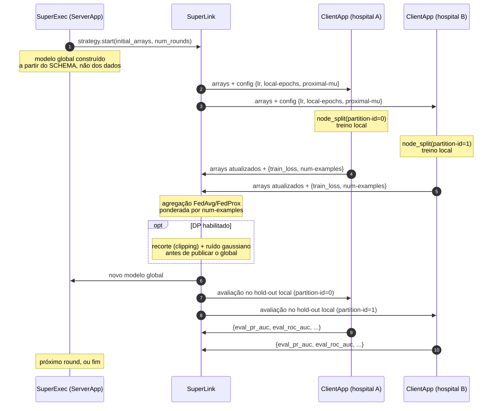
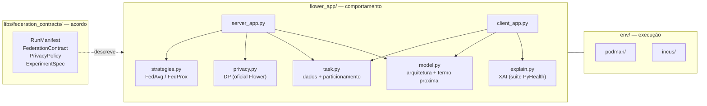
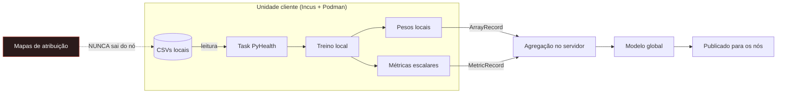

# Arquitetura

Documento de referência da camada de federação. Descreve a topologia, o caminho
de um round federado, a fronteira de dados e onde cada requisito do projeto
(non-IID, privacidade, explicabilidade, validação externa) está implementado.

## 1. Visão geral

O sistema treina um modelo de alerta antecipado de deterioração clínica sem
centralizar prontuários. Cada instituição mantém seus registros localmente e
troca apenas **parâmetros de modelo** e **escalares de métrica**.

Há dois runtimes, e o mesmo código de aplicação roda nos dois:

| Runtime | Quando usar | Onde o código roda |
| --- | --- | --- |
| **Simulation Runtime** (Ray) | Desenvolvimento, reprodução de experimentos, varredura de hiperparâmetros | Processos locais geridos pelo Ray |
| **Deployment Runtime** | Exercitar a pilha real de comunicação; base para o rollout multi-instituição | SuperLink + SuperNodes + SuperExecs em contêineres |

Essa escolha é o motivo de a aplicação ser escrita no modelo `ServerApp`/`ClientApp`
do Flower: os objetos são **idênticos** nos dois runtimes, então alternar entre
simulação e deployment não exige mudança de código.

## 2. Topologia de componentes



**Regra de fronteira:** o único fluxo que cruza unidades é `SuperNode → SuperLink:9092`.
O inventário completo de portas e quais podem ser expostas está em
`env/incus/PORTS.md`.

### 2.1 Modelo lógico: componentes, unidades e interfaces

A topologia acima descreve **processos**. O modelo abaixo descreve **unidades e
interfaces** — a mesma federação vista pelo que cada peça oferece e exige. Ele
está versionado em `libs/federation_components/`, e é contra ele que qualquer
descritor de implantação é verificado:

```bash
python -m libs.federation_components
```

**Dois componentes.** `comunicação` carrega o que é de longa duração e só
roteia; `exec` carrega o que executa código, e é o único que lê prontuário.

| Componente | Unidade | Processo | Provê | Requer |
| --- | --- | --- | --- | --- |
| comunicação | `link` | `flower-superlink` | `appio`, `fleet`, `control` | — |
| comunicação | `node` | `flower-supernode` | `appio` | `fleet` |
| exec | `exec-server` | `flower-superexec --plugin-type serverapp` | — | `appio` |
| exec | `exec-client` | `flower-superexec --plugin-type clientapp` | — | `appio` |

**Três ligações, uma delas cruza a fronteira.**

| Ligação | Porta | Escopo |
| --- | ---: | --- |
| `exec-server → link` | 9091 | intra-unidade |
| `exec-client → node` | 9094 | intra-unidade |
| `node → link` | 9092 | **inter-unidade** |



**Invariante, e em que nível.** `appio` nunca cruza fronteira de unidade física —
de contêiner: um SuperExec fala com o SuperLink ou o SuperNode ao seu lado, e só
`fleet` cruza. `env/incus/PORTS.md` enuncia a mesma regra no nível da instituição
(a unidade Incus), que é mais fraco. A escolha pelo nível do contêiner é
deliberada (decisão de 2026-09-25, `HPC_SHELF_ROADMAP.md` Fase 3): separar as
quatro unidades em contêineres distintos manteria `appio` dentro da instituição,
mas o tiraria do loopback e o poria na rede. Optou-se por manter o agrupamento e o
loopback — de modo que o agrupamento é **propriedade defendida**, não concessão à
plataforma. O código `M103` acusa qualquer realização que separe um SuperExec do
seu provedor de AppIO.

**Lógico × físico.** O modelo acima é lógico. A realização física agrupa
`link`+`exec-server` numa unidade e `node`+`exec-client` noutra — `hub`/`hospital`
neste repositório, `aggregator`/`client` no catálogo da plataforma — porque na HPC
Shelf a dependência horizontal só resolve dentro do mesmo componente e cada
réplica de host comporta uma única réplica interna. O agrupamento é uma
**realização**, não o modelo: as duas grafias reduzem ao mesmo modelo, e é isso
que `libs/federation_components` verifica. Separar em quatro unidades é a opção B
de `HPC_SHELF_INTEGRATION.md` seção 4 — agora **construída e medida**, não só
argumentada (abaixo); o que falta na plataforma é `scope: parent`, que a tornaria
segura, não possível.

**A realização separada existe e é medida.** `env/hpcshelf/arms/three-level/`
materializa a opção B como descritores, 4 imagens de unidade e dois provadores:
9 unidades em 3 níveis, com `appio` publicado em `10.201.0.{1,2,3}:30000` — medido
pelo **mesmo** `EndpointPublisher` que mede o braço agrupado, onde o resultado é
`0`. A ligação vertical **não** é declarável (`dependencies` no pai → `C002`) e é
realizada lendo o plano do próprio pai (`UnitPlan.children[].services[]` +
`127.0.0.1:<published_port>`); `scripts/smoke_hpcshelf_three_level.sh` exercita
isso e o caso negativo.



`M103` continua acusando essa realização, e por isso ela **não** é registrada em
`libs/federation_components`: um verificador com exceção para o caso que ele
existe para pegar seria mais fraco. O desempate continua sendo `scope: parent`.
O que a separação **compra**, e que é verificável no artefato: as unidades de
transporte (`flower-link`, `flower-node`) não contêm `data/`, `flower_app`, torch
nem PyHealth — 1,1 GB contra 7,3 GB —, de modo que quem carrega parâmetros não
consegue ler prontuário.

**Fronteira de dados.** A única unidade que lê prontuário é `exec-client`; o
`node` ao lado é um carteiro cego. O modelo registra isso (`touches_data`) e o
verificador exige que essa unidade esteja dentro de uma fronteira de dados
(código `M105`).

**Ressalva.** O lado servidor do rascunho atual chama `load_samples()` em
`flower_app/server_app.py` para fixar vocabulário e formato de embedding, o que
na prática lê o dataset demo no servidor. A intenção registrada é derivar apenas
o *schema*; a implementação ainda não separa as duas coisas. Fica para a Fase 7
(governança), com a fronteira de dados.

## 3. Um round federado



## 4. Onde cada requisito vive



| Requisito do projeto | Onde está implementado | Como é verificado |
| --- | --- | --- |
| Heterogeneidade **non-IID** | `task.shard` / `partition_patient_ids` com os esquemas `uniform` e `label-skew` | `tests/test_partitioning.py`, `test_pipeline.py::test_label_skew_*` |
| **DP** como requisito arquitetural | `privacy.maybe_wrap_dp` envolve a estratégia com os mecanismos oficiais do Flower | `tests/test_strategies_privacy.py` |
| **XAI** | `explain.py` sobre a suíte `pyhealth.interpret` (`IntegratedGradients`, `DeepLift`, `GIM`, `LIMe`, `SHAP`, `Chefer`) | `test_pipeline.py::test_interpretability_*` |
| **Validação federada vs centralizada** | Hold-out compartilhado, nunca treinado, em `task.node_split`; comparado por `scripts/central_baseline.py` | asserção de hold-out idêntico no próprio script |
| **Auditoria / governança** | `libs/federation_contracts` serializa o que foi acordado e executado | `tests/test_contracts.py` |

## 5. Fronteira de dados



O que **cruza** o limite do nó, exaustivamente:

* `ArrayRecord` — pesos do modelo;
* `MetricRecord` — escalares (`train_loss`, `num-examples`, `eval_pr_auc`, …).

O que **nunca** cruza: amostras, `visit_id`, `patient_id`, mapas de atribuição
(XAI), checkpoints intermediários. Os mapas de atribuição apontam para códigos e
internações individuais, portanto são dado derivado de paciente e permanecem
dentro da unidade.

## 6. Decisões e justificativas

| Decisão | Escolha | Justificativa |
| --- | --- | --- |
| Runtime de desenvolvimento | Simulation Runtime (Ray) | É o modo padrão de `flwr run`; o backend é o `RayBackend`. Permite varrer esquemas de partição e orçamentos de privacidade sem infraestrutura. |
| Agregação baseline | `FedAvg` | McMahan et al., *Communication-Efficient Learning of Deep Networks from Decentralized Data*, AISTATS 2017. |
| Agregação para non-IID | `FedProx` | Li et al., *Federated Optimization in Heterogeneous Networks*, MLSys 2020. O termo proximal existe justamente para o regime que `label-skew` produz. |
| Onde aplicar o termo proximal | `forward()` do modelo | `pyhealth.trainer.Trainer` lê `output["loss"]` direto do modelo e não usa `get_loss_function`; envolver `forward` preserva métricas, early stopping e reload do melhor checkpoint do PyHealth. |
| Mecanismo de DP | `DifferentialPrivacyServerSideFixedClipping` | Já vem no Flower 1.34; não requer alteração no cliente. Ver a ressalva de confiança em `privacy.py`. |
| Partição por paciente, não por amostra | `task.node_split` | Um paciente pode ter várias internações. Particionar por amostra colocaria internações do mesmo paciente em nós diferentes — vazamento entre nós. |
| Split implementado localmente | não usar `split_by_patient` | Os subsets retornados por `split_by_patient` não expõem mapeamento utilizável: `patient_to_index` continua listando **todos** os pacientes, e os índices inteiros são rebaseados para o subset. As duas propriedades tornam fácil construir um split que vaza sem parecer errado. Ver o docstring de `task.py`. |
| `partition-id` obrigatório | erro explícito se ausente | Em simulação, `node_id` é um identificador de 64 bits (ex.: `6677547757711064239`), não um índice. Assumir `0` faria todos os nós treinarem na mesma partição e ainda assim reportarem resultado "federado". |
| Hold-out compartilhado | pool de teste nunca particionado | Sem ele não existe base comum para comparar modelo federado e centralizado. |
| Configuração de DP desligada por padrão | `dp-mode = "none"` | Ligar DP muda os números. O orçamento de privacidade deve ser escolha registrada, nunca default silencioso. |

## 7. Limitações conhecidas

* **O demo tem 100 pacientes.** Após o split, o pool de validação tem 4 pacientes
  e o hold-out, 5. As métricas são ruidosas por construção: o demo serve para
  exercitar o pipeline, não para conclusão estatística. Escale com
  `PYHEALTH_EHR_ROOT` apontando para o MIMIC-IV credenciado completo.
* **DP central.** O servidor vê as atualizações individuais antes de agregar. Um
  cenário que não confie no servidor exige recorte no cliente mais agregação
  segura, ambos fora do escopo do protótipo.
* **Sem agregação segura.** Não implementada; ver acima.
* **`--insecure` no deployment.** Os certificados são gerados por
  `env/podman/certs.yml`, mas ainda não estão em uso.
* **Sem Split Learning.** Está no plano de trabalho como terceira estratégia e
  não está implementado.
