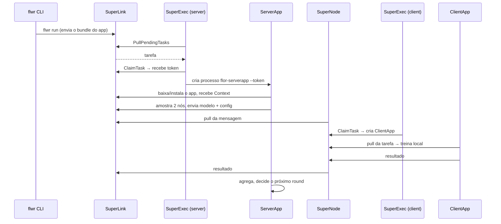

# Flower: como funciona

> Para quem nunca usou o Flower e precisa entender o **workflow** dele, com foco na
> **camada de runtime** — o suficiente para julgar onde a plataforma de unidades
> encaixa. Versão de referência: Flower 1.34.

## 1. O problema

Aprendizado federado = várias instituições treinam **um** modelo sem centralizar
dados. Alguém precisa coordenar: escolher quem participa, enviar o modelo, receber
atualizações, agregar. O Flower é o que faz esse transporte.

A topologia é sempre **hub-and-spoke**: um servidor, N clientes. Não há coletivo,
não há barreira global, não há SPMD. É um cliente-servidor com filas.

## 2. A ideia central: separar transporte de aplicação

O Flower divide cada lado em duas partes:

| | Transporte (longo, genérico) | Aplicação (curto, do projeto) |
| --- | --- | --- |
| **servidor** | `SuperLink` | `ServerApp` |
| **cliente** | `SuperNode` | `ClientApp` |
| **quem lança o app** | `SuperExec` (launcher, de longa duração) | — |
| **quem escreve** | ninguém (binário) | o pesquisador |

```text
                    hub
   flwr CLI ─────▶ SuperLink ◀──── SuperExec ──spawn──▶ ServerApp
                    ▲
                    │  :9092  (única travessia entre instituições)
        ┌───────────┴───────────┐
        │                       │
   hospital A               hospital B
   SuperNode ◀─ SuperExec ─spawn─▶ ClientApp ─▶ dados locais
   SuperNode ◀─ SuperExec ─spawn─▶ ClientApp ─▶ dados locais
```

Consequências:

* o **transporte nunca vê dado de paciente** nem carrega `torch`. Ele recebe
  mensagens e as repassa;
* o **código do pesquisador** é só o app: treino local, configuração, agregação.
  `FedAvg` não é um serviço — é uma classe instanciada dentro do `ServerApp`;
* o **runtime não conhece o algoritmo**. Só conhece processos, endereços e
  mensagens.

## 3. O workflow de um run

Um "run" é um job identificado por `run_id`. Ele não sobe a infraestrutura: ele é
**submetido** a uma federação que já está de pé.



Em nove passos:

1. `flwr run` empacota o diretório do app num **FAB** (código + declaração de
   dependências, sem dados e sem pesos) e o envia ao `SuperLink`;
2. o `SuperExec` do servidor faz *poll* de tarefas pendentes e **reivindica** uma;
3. ele cria o processo `ServerApp`, que baixa e instala o FAB;
4. o `ServerApp` constrói o modelo global e a estratégia, e pede ao `SuperLink`
   que amostre N nós;
5. a mensagem fica **enfileirada** no `SuperLink` até um `SuperNode` fazer *pull*;
6. o `SuperNode` recebe, e o `SuperExec` do cliente é quem cria o `ClientApp`;
7. o `ClientApp` busca a tarefa, treina sobre o split local (identificado por
   `node_config`) e devolve o resultado;
8. o `SuperNode` repassa o resultado ao `SuperLink`; o `ServerApp` agrega;
9. ao terminar, o `SuperExec` colhe o processo e o log fica no `SuperLink`
   (`flwr log <run_id>`).

Duas propriedades que definem tudo: **tudo disca** (os daemons nunca iniciam
conexão para baixo) e **nada é empurrado até o destinatário final** (cada ponta
busca). O hospital só precisa de conectividade de saída.

## 4. A camada de runtime em detalhe

### 4.1 `SuperLink` — o broker

* Mantém a frota de `SuperNode` registrados e o estado dos runs;
* mantém **filas** de mensagens: `ServerApp → nós` e `nós → ServerApp`;
* expõe três APIs: **Fleet** (`:9092`, para os nós), **AppIO/Runtime** (`:9091`,
  para o `SuperExec` e o `ServerApp`) e **Control** (`:9093`, para o `flwr` CLI);
* não agenda rounds, não agrega, não guarda o modelo global. Sem `--database`,
  todo o estado (inclusive `run_id` e logs) vive em memória.

### 4.2 `SuperNode` — o agente do site

* Registra-se no `SuperLink` e faz *pull* de mensagens (é sempre ele quem inicia);
* **não interpreta** o conteúdo: repassa arrays e escalares ("carteiro cego");
* serve o AppIO local (`:9094`) para o `SuperExec` do seu lado;
* carrega a identidade local do nó (`--node-config "partition-id=0 ..."`), que é
  o **único** canal de configuração por nó — ela chega ao app em
  `Context.node_config`.

### 4.3 `SuperExec` — o launcher, e o pedaço que mais importa

O `SuperExec` **não é passivo**. Ele é um *worker* de uma fila de tarefas:

```python
while True:
    tasks = stub.PullPendingTasks(...)          # a cada 1 s
    task  = plugin.select_task(tasks)           # pode recusar
    if task:
        executor.wait_for_capacity()
        token = stub.ClaimTask(task.task_id)    # lease
        if token:
            plugin.launch_task(token, task)     # spawn do processo
```

O que isso implica:

* **`claim` é atômico.** Dois `SuperExec` no mesmo AppIO não duplicam trabalho: um
  recebe o token, o outro fica sem tarefa.
* **O token é uma *lease* com heartbeat (30 s).** Se o app nunca chega a ativar, a
  tarefa volta para `PENDING` e é retentada. Se ele já está rodando e o heartbeat
  para, a tarefa vira `FINISHED/FAILED` — **não** é retentada. Matar um app no meio
  do round, portanto, **produz um resultado** (um cliente a menos), não um atraso.
* **O launcher amarra o tempo de vida.** O processo de app nasce com
  `--parent-pid` do `SuperExec`: morre o launcher, morre o app.
* **A tarefa espera.** Se o `SuperExec` estiver fora, nada se perde — e nada
  progride. Um container "verde" sem AppIO alcançável é indistinguível de um ocioso.

O `SuperExec` também é o que separa dependências: ele é criado pela plataforma
(ver 5.2) e o processo de app **herda o seu sistema de arquivos, bibliotecas e
cgroup**. É por isso que só a imagem de execução carrega PyTorch/PyHealth.

### 4.4 O processo de app

* `ServerApp` e `ClientApp` são **efêmeros**: existem durante um run;
* são **clientes** do runtime (AppIO), nunca servidores;
* instalam o FAB na primeira interação e devolvem o `Context` no fim;
* um `ClientApp` só existe no nó que o `ServerApp` amostrou para aquele run.

### 4.5 O caminho de uma mensagem

```text
ServerApp ─push─▶ [fila SuperLink] ─pull─▶ SuperNode ─▶ [fila SuperNode] ─pull─▶ ClientApp
ServerApp ◀pull─  [fila SuperLink] ◀push─ SuperNode ◀─ [fila SuperNode] ◀push─  ClientApp
```

Quatro processos e duas filas por sentido. Assincronia é estrutural: um nó lento
não bloqueia, apenas entrega depois do *deadline*. **Quantos resultados um round
tem é decisão do `ServerApp`** (a estratégia tolera falhas e agrega o que chegou),
não do transporte.

### 4.6 Ciclo de vida, em uma tabela

| Processo | Criado por | Morre quando | Efeito da morte |
| --- | --- | --- | --- |
| `SuperLink` / `SuperNode` | plataforma | a unidade para | federação perde o papel; no braço de 3 níveis o status da unidade reflete o processo |
| `SuperExec` | plataforma | a unidade para | tarefas pendentes ficam fila; `STARTING` volta à fila em 30 s |
| `ServerApp` / `ClientApp` | `SuperExec` | fim do run, ou morte do `SuperExec` | round fecha com menos resultados |

## 5. Como isso vira contêiner

### 5.1 Quatro imagens

| Imagem | Contém | Roda |
| --- | --- | --- |
| `flwr/superlink` | só runtime | `flower-superlink` |
| `flwr/supernode` | só runtime | `flower-supernode` |
| `flwr/superexec` | só runtime | `flower-superexec` |
| imagem de app | base + torch/PyHealth + `flower_app` (+ dados, no cliente) | `flower-superexec`; o app é filho |

O Flower **não tem conceito de contêiner**. Ele só sabe endereços e processos. O
contêiner é a resposta da plataforma a "onde esses processos vivem e o que
alcançam" — e é por isso que a junção é limpa.

### 5.2 Dois modos de isolamento

| Modo | Quem cria o `SuperExec` | Por lado |
| --- | --- | --- |
| `--isolation subprocess` (default) | o próprio `SuperLink`/`SuperNode` | 1 contêiner |
| `--isolation process` | quem orquestra (compose, plataforma) | 2 contêineres (transporte ≠ app) |

`process` é o modo que permite separar transporte de execução. Nele, o endereço do
AppIO deixa de ser local e passa a ser passado na linha de comando.

### 5.3 Portas (Flower 1.34)

| Porta | Onde | Quem disca | Cruza unidade? |
| --- | --- | --- | --- |
| 9091 | `SuperLink` | `SuperExec`/`ServerApp` | não |
| 9092 | `SuperLink` | `SuperNode` | **sim** (só de cliente) |
| 9093 | `SuperLink` | `flwr` CLI | só rede de admin |
| 9094+ | `SuperNode` | `SuperExec`/`ClientApp` | não |

Duas armadilhas reais: porta do listener e porta que o par disca têm que casar
(senão o round nunca fecha, sem erro fatal); e só use loopback quando o par está no
mesmo namespace.

## 6. O que a plataforma precisa fornecer

1. **Rede com ACL por porta**: só `9092` entre unidades; `9093` só na administração.
2. **Prontidão = AppIO aceitando conexão**, não "container iniciado". `depends_on`
   ordena início, não readiness — e o Flower retenta para sempre por default.
3. **Ciclo de vida**: reiniciar daemons (`SuperLink`/`SuperNode`/`SuperExec`), nunca
   os processos de app (quem os cria e colhe é o `SuperExec`).
4. **Recursos na unidade certa**: o app herda o cgroup do `SuperExec`; limitar o
   `SuperNode` não limita o treino.
5. **Mesma versão em todas as unidades**: as Runtime APIs recusam `major.minor`
   incompatível.
6. **Log do run, não do contêiner**: o `stdout` do app é redirecionado; o log é
   artefato do `SuperLink` (`flwr log`).

## 7. O que o Flower não faz (fronteira com a plataforma)

* não escolhe clientes, não define rounds, não agrega — isso é o `ServerApp`;
* não persiste modelo global (vive no processo do `ServerApp`);
* não persiste estado nem log sem `--database`;
* não conhece contêiner, cgroup, GPU ou volume;
* não faz *push* para o cliente: é fila + pull;
* não reinicia app caído — o que caiu depois de iniciar é **falha**, não retry;
* não faz mTLS (só TLS de servidor; `--insecure` no protótipo).

Tudo o que está nessa lista é responsabilidade da plataforma. E tudo o que a
plataforma precisa saber está na seção 6.

---

Versão longa (detalhes de implementação, braços plano × 3 níveis, checklist de 16
erros conceituais): `docs/FLOWER_REFERENCIA.md`.
