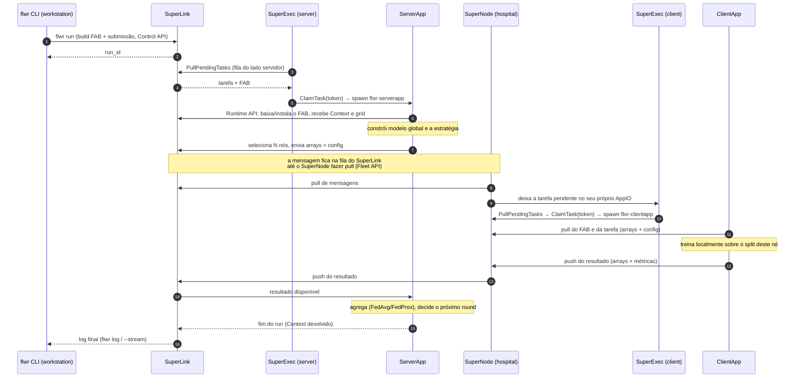

# Flower: modelo de execução e implementação em contêineres

> **Para quem é este documento.** Orientador (HPC / Linguagens de Programação) que
> precisa entender o Flower o suficiente para auditar a junção dele com a
> plataforma de unidades (Incus + Podman + registry + gRPC). Não é tutorial de FL
> nem manual de API: é a descrição do **modelo de execução** — quem é processo,
> quem é dado, quem disca para quem, o que viaja pela rede e o que sobe quando.
>
> **Procedência.** Escrito a partir de (a) os binários e o código de Flower
> **1.34.0** instalados neste repositório, (b) a documentação oficial de
> arquitetura/rede/deployment, (c) `podman-compose.yml` + `docs/DEPLOYMENT.md`
> (braço plano) e (d) `env/hpcshelf/arms/three-level/` — descritores, supervisores
> e `README.md` (braço de 3 níveis). Onde os dois braços divergem, o documento diz
> qual está sendo descrito. Versões ≥ 1.35 mudam a fiação de rede: §11.

---

## 0. Resumo em seis linhas

1. O Flower separa **transporte** (processos de longa duração, que só roteiam) de
   **aplicação** (processos de curta duração, que executam código do usuário).
2. `ServerApp` e `ClientApp` são **código do usuário**: o laço federado, a seleção
   de clientes e a agregação são do pesquisador.
3. O runtime **não conhece FedAvg** — e **não conhece contêiner**. Ele conhece
   *endereços* e *processos*. Contêiner é a resposta da plataforma a "onde esses
   processos vivem e o que eles alcançam".
4. O `SuperExec` é um **worker de uma fila de tarefas**: faz *pull* de tarefa
   pendente, **reivindica** (`claim`) com um token e só então cria o processo.
5. Nenhuma entrega é empurrada até o destinatário final: cada mensagem atravessa
   **duas filas e quatro processos**, e o lado de baixo é sempre quem inicia.
6. "Deploy automático" é uma etapa **separada** de "subir a infraestrutura" (§8) —
   e no braço de 3 níveis ela está hoje **bloqueada**, porque a Control API
   (`:9093`) não é declarada nem publicada.

---

## 1. O que o Flower é, dito em termos de linguagem e sistema

Três coisas ao mesmo tempo, e confundi-las é a origem da maior parte dos
mal-entendidos:

| Camada | O que é | Quem escreve |
| --- | --- | --- |
| **Biblioteca** | `ServerApp`/`ClientApp`, decoradores `@app.main`, `@app.train`, `@app.evaluate`, tipos `Message`, `ArrayRecord`, `ConfigRecord`, `Context`, estratégias (`FedAvg`, `FedProx`) | o pesquisador |
| **Runtime** | Processos de infraestrutura (`SuperLink`, `SuperNode`, `SuperExec`) que transportam mensagens e lançam os processos da aplicação | ninguém — são binários |
| **Artefato/CLI** | O *bundle* da aplicação (FAB) e a ferramenta `flwr` que o constrói e submete | o pesquisador, via comando |

Consequência para a pesquisa: **o algoritmo federado é código de aplicação**.
`FedAvg` não é serviço do servidor; é uma classe instanciada dentro do `ServerApp`,
que roda no processo do `ServerApp`. Trocar FedAvg por FedProx é trocar uma linha
de código de usuário, não reconfigurar o runtime.

### Comparação com o modelo mental de HPC

O reflexo natural é ler FL como SPMD com *all-reduce*. Não é.

| | MPI / SPMD | Flower |
| --- | --- | --- |
| Processos | todos iguais, lançados juntos | dois programas distintos, lançados **sob demanda** |
| Comunicação | coletivos sobre um *communicator* | RPC ponto-a-ponto, modelo *pull* |
| Barreira | `MPI_Barrier` global | não existe; há *deadline* de round no código do servidor |
| Falha de um rank | aborta o job (por default) | tolerada: o round agrega o que chegou |
| Quem decide o quê | o programa | o `ServerApp` decide quem participa, o que enviar e como agregar |
| Escala | forte, acoplada | fraca, dispersa, heterogênea |

O análogo correto não é `mpirun`; é **batch com fila de tarefas**: um *resource
manager* (`SuperLink`), um *node agent* por site (`SuperNode`), um *launcher*
(`SuperExec`) e um *job* (`ServerApp`/`ClientApp`) que só existe durante a execução.

---

## 2. Os cinco componentes

```text
[admin]      flwr CLI ──── Control :9093 ───▶ SuperLink

[hub]        SuperLink ◀── AppIO :9091 ── SuperExec ──spawn──▶ ServerApp

             SuperLink ◀── Fleet :9092 ── SuperNode     (pull; única travessia
                                                         entre unidades)

[hospital]   SuperNode ◀── AppIO :9094 ── SuperExec ──spawn──▶ ClientApp
                                                                    │
                                                              dados locais
                                                        (só o ClientApp lê)
```

| Componente | Tempo de vida | Função | Guarda estado? |
| --- | --- | --- | --- |
| **SuperLink** | longo | ponto central: recebe *runs*, mantém a frota, enfileira e roteia mensagens | sim (`state.db`, opcional) |
| **SuperNode** | longo | agente do site: registra-se, faz *pull* de tarefas, devolve resultados, serve o FAB | não (é carteiro) |
| **SuperExec** | longo | *launcher*: faz *pull* de tarefas pendentes, **reivindica** e **cria** o processo de app | não |
| **ServerApp** | curto (por run) | política federada: seleção, configuração, agregação, avaliação | não |
| **ClientApp** | curto (por run, por nó amostrado) | treino/avaliação sobre os dados daquele nó | não |

**Dois planos.** `SuperLink` e `SuperNode` estão no **plano de transporte**: cegos a
código de usuário, nunca veem dado de paciente, nunca executam `torch`.
`SuperExec` e os processos de app estão no **plano de execução**: é onde o código
do usuário roda e — no cliente — o único lugar que toca prontuário. No braço de 3
níveis isso é **propriedade do artefato**, não promessa de comportamento: a imagem
de transporte não contém `flower_app`, `libs`, `data/`, torch nem PyHealth
(~1,1 GB contra ~7,3 GB), e `scripts/smoke_hpcshelf_three_level.sh` verifica isso
na imagem.

`ServerApp` e `ClientApp` são **efêmeros**: nascem quando o run começa, morrem
quando ele termina. Um `ClientApp` só existe no nó que o `ServerApp` *amostrou*
para o run — os demais nós ficam ociosos, com o daemon de pé.

---

## 3. O artefato: o que exatamente é "a aplicação"

Uma *Flower App* é um diretório com código Python e um `pyproject.toml` que declara
dois *entrypoints* e um mapa de configuração efêmera:

```toml
[tool.flwr.app.components]
serverapp = "flower_app.server_app:app"   # objeto ServerApp
clientapp = "flower_app.client_app:app"   # objeto ClientApp

[tool.flwr.app.config]
num-server-rounds = 3
strategy = "fedavg"
proximal-mu = 0.0
```

`flwr build` empacota esse diretório num **FAB**: um arquivo único com o código e a
**declaração** de dependências. O FAB **não** contém dados, pesos, nem as
dependências já instaladas — por isso a imagem que executa a app precisa ser
construída com elas.

| Comando | Ação | Toca contêiner? |
| --- | --- | --- |
| `flwr build` | empacota o diretório num `.fab` | não |
| `flwr run . <conexão>` | empacota e **submete** à federação já em execução; devolve `run_id` | não — só fala com o `SuperLink` |
| `flwr install x.fab` | instala um FAB localmente em `~/.flwr/apps/` | não |
| `flwr list` / `log` / `stop` / `pull` | inspeciona, acompanha, aborta, coleta artefatos | não |

**`flwr run` não sobe nada**: não cria contêiner, não agenda nó, não reserva GPU.
Entrega um pacote a um broker que já está no ar.

---

## 4. O fluxo de um run, passo a passo



O que merece atenção conceitual:

* **Tudo disca, ninguém é chamado de fora.** `SuperNode` inicia a conexão com o
  `SuperLink`; `SuperExec` inicia a conexão com o seu par; o processo de app inicia
  a conexão com o runtime. Só `SuperLink` e `SuperNode` **escutam** portas de
  serviço, e apenas para os processos do seu lado. Um hospital não abre porta de
  entrada: só saída.
* **O `SuperNode` é um carteiro cego.** Transporta arrays e escalares; não
  interpreta payload e não tem acesso ao prontuário.
* **O relógio do round é do `ServerApp`.** O `SuperLink` não agenda rounds; um
  *round timeout* é um `deadline` no código do servidor, não garantia de
  escalonamento.
* **O `Context` é o ambiente do job**: `run_id`, `node_config` (identidade local do
  nó) e `run_config` (o mapa do `pyproject.toml`, sobrescrevível por
  `--run-config`).
* **Multi-tenancy.** O mesmo `SuperLink` e a mesma frota servem vários runs ao
  mesmo tempo; o `ClientApp` de um run só existe no nó amostrado para aquele run.

---

## 5. A camada de runtime, em detalhe

Esta é a seção que interessa para a junção com a plataforma. Ela descreve o que o
runtime do Flower **é**, independentemente de onde os processos rodam.

### 5.1 Três eixos ortogonais (e nenhum deles é "contêiner")

Quem diz "Flower em contêiner" costuma colapsar três decisões diferentes numa só.
São independentes:

| Eixo | Pergunta | Opções | Quem decide |
| --- | --- | --- | --- |
| **A. Propriedade do `SuperExec`** | quem cria o launcher? | `--isolation subprocess` (o daemon cria) / `process` (agente externo cria) | flag do `SuperLink`/`SuperNode` |
| **B. Executor do `SuperExec`** | como o launcher cria o processo de app? | `--executor subprocess` (default) / `kubernetes` (cria Pod) | flag do `SuperExec` |
| **C. Onde o processo vive** | qual namespace/FS/cgroup ele herda? | o contêiner em que o `SuperExec` está | **a plataforma**, não o Flower |

O Flower só tem vocabulário para A e B. **C é inteiramente da plataforma** — e é
por isso que a junção é limpa: o Flower nunca precisa saber que Incus ou Podman
existem, e a plataforma nunca precisa saber o que é um round.

Corolário prático: **cada vez que o `SuperExec` é movido de contêiner, o endereço
do AppIO muda, e nada mais muda.** Em `process`, o `SuperExec` é um processo
externo que alguém (compose, plataforma, supervisor) tem que criar e cujo endereço
tem que ser passado na linha de comando (`--appio-api-address` /
`--clientappio-api-address`).

### 5.2 O protocolo do launcher: fila, reivindicação, lançamento

O `SuperExec` não é um alvo de *push*. Ele é um **worker de fila**. O laço real do
1.34 (`flwr/supercore/superexec/run_superexec.py`) é:

```python
while True:
    tasks_res = stub.PullPendingTasks(request=PullPendingTasksRequest())
    task = plugin.select_task(tasks_res.tasks)        # o plugin pode recusar
    if task is not None:
        executor.wait_for_capacity()                  # gate de concorrência
        claim_res = stub.ClaimTask(ClaimTaskRequest(task_id=task.task_id))
        if claim_res.token:                           # lease concedido
            plugin.launch_task(token=claim_res.token, task=task)
    time.sleep(1)
```

E o processo filho é criado assim (executor `subprocess`):

```text
flwr-serverapp --appio-api-address <addr> --token <token> [--parent-pid <pid>] [--insecure]
flwr-clientapp --clientappio-api-address <addr> --token <token> [--parent-pid <pid>] [--insecure]
```

Consequências que mudam o desenho da plataforma:

1. **A fila absorve indisponibilidade — mas só até o claim.** Tarefa não
   reivindicada fica `PENDING` indefinidamente; não se perde, mas não progride. Um
   `SuperExec` "verde e inútil" é indistinguível, do lado do `SuperLink`, de um
   `SuperExec` saudável e ocioso.
2. **`claim` é *at-most-once*.** `claim_task` é atômico e devolve `None` se a
   tarefa já está em `task_token_store` ou já não está `PENDING`. Dois `SuperExec`
   no mesmo AppIO competem pelo mesmo `task_id`; só um recebe token. É por isso que
   subir um `SuperExec` duplicado não duplica o treino silenciosamente — ele fica
   sem tarefa.
3. **O token é uma *lease* com heartbeat, de 30 s.** O claim move a tarefa para
   `STARTING` e grava `active_until = now + HEARTBEAT_DEFAULT_INTERVAL`; o processo
   de app precisa renovar por `SendTaskHeartbeat`. O estado da tarefa é, então:

   ```text
   PENDING ──ClaimTask──▶ STARTING ──activate──▶ RUNNING ──finish──▶ FINISHED
      ▲                      │                      │
      └── lease expira ──────┘                      └─ lease expira ─▶ FINISHED(failed)
          (nunca ativou: volta p/ fila)                 (parou o heartbeat: NÃO retenta)
   ```

   Consequência forte para a plataforma: **matar um processo de app no meio do
   round não é um atraso, é um resultado.** A tarefa é marcada como
   `FINISHED/FAILED` ("No heartbeat received from the task") e o `ServerApp`
   agrega o que chegou. Já um crash **antes** de ativar devolve a tarefa à fila e é
   retentado de graça.
4. **O token é a capacidade.** O processo de app nasce com `--token`; é com ele que
   se apresenta ao runtime. O `SuperExec` autoriza o nascimento, o runtime autoriza
   a execução.
5. **`--parent-pid` amarra o tempo de vida.** O `SuperExec` sempre passa o próprio
   PID (`parent_pid=os.getpid()` em `base_exec_plugin`); quando ele morre, o
   processo de app morre junto. Não há processo órfão rodando um round.
6. **Piso de latência de 1 s** por ciclo de *poll*, por launcher. Irrelevante em FL
   (rounds duram minutos), mas explica por que "subi o container e nada acontece"
   tem, tipicamente, 1 s de atraso.

### 5.3 O contrato AppIO: o app também é cliente

Os dois processos de app são **clientes** da mesma API que o `SuperExec` usa:

| Quem disca | Para quem | Para quê |
| --- | --- | --- |
| `SuperExec` (server) | `SuperLink` `:9091` | descobrir tarefas pendentes, reivindicar, lançar |
| `ServerApp` | `SuperLink` `:9091` | puxar FAB + `Context`, enviar/receber mensagens, devolver `Context` no fim |
| `SuperExec` (client) | `SuperNode` `:9094` | descobrir tarefas pendentes, reivindicar, lançar |
| `ClientApp` | `SuperNode` `:9094` | puxar FAB + tarefa, devolver resultado |

Nenhum deles escuta. **Os daemons nunca discam para baixo**; o fluxo é sempre
iniciado pelo lado de execução. Isso é o que permite ao hospital exigir apenas
conectividade de saída e o que dá à plataforma um plano de firewall trivial.

### 5.4 A cadeia de uma mensagem: duas filas, quatro processos

```text
ServerApp ──push──▶ [fila no SuperLink] ──pull──▶ SuperNode ──▶ [fila no SuperNode] ──pull──▶ ClientApp
ServerApp ◀──pull── [fila no SuperLink] ◀─push── SuperNode ◀── [fila no SuperNode] ◀─push── ClientApp
```

Cada direção atravessa **quatro processos e duas filas**, e nenhuma entrega é
empurrada até o destinatário final: o `ClientApp` busca, o `ServerApp` busca. Duas
consequências:

* **Assincronia é estrutural, não uma otimização.** Um nó lento não bloqueia a
  fila; ele simplesmente entrega depois do *deadline* — e o `ServerApp` decide o
  que fazer com isso.
* **O número de resultados de um round é uma decisão do `ServerApp`, não do
  transporte.** O `FedAvg` do 1.34 **não tem** `accept_failures`: sempre tolera
  falha e agrega o que chegou, logando em `INFO`. `min_train_nodes` controla apenas
  a **amostragem**. Ver §10, item 6.

### 5.5 Onde o FAB entra no runtime

O FAB não é montado nem copiado pelo orquestrador. Ele é **puxado pelo processo de
app**, na primeira interação com o runtime, e instalado em `$FLWR_HOME/apps/`
(o log do `ServerApp` mostra `Successfully installed <app> to /app/.flwr/apps/...`).
O `SuperExec` apenas cria o processo; quem baixa, instala e importa o *entrypoint*
é o processo.

Isso fixa três invariantes:

1. **O FAB é o único código que entra numa unidade cliente.** A plataforma não
   precisa distribuir código entre unidades: o `SuperLink` distribui, o `SuperNode`
   retransmite, o app instala.
2. **A imagem precisa ter as dependências; o FAB só as declara.** Instalar
   dependência em tempo de execução existe
   (`--allow-runtime-dependency-installation`), mas é a exceção, não o caminho.
3. **Mudar o código não exige reconstruir imagem** — desde que as dependências não
   mudem. Mudou dependência, reconstrói (é o que o quickstart oficial manda fazer).

### 5.6 Identidade: `node_config` é o único canal

Não existe configuração por nó dentro do FAB. A identidade local de um nó viaja por
**um** caminho: `--node-config` do `SuperNode` → `Context.node_config` do
`ClientApp`. No braço de 3 níveis ela é derivada da plataforma:
`partition-id = plan.replica`, e o `overlap` garante
`node[i].replica == exec-client[i].replica` — o `validate.py` verifica isso, porque
uma divergência faria o `ClientApp` treinar sobre o split de outro hospital
enquanto o run ainda reportaria números "federados".

Por isso o `ClientApp` deste projeto **falha** quando `partition-id` está ausente
em vez de adivinhar: adivinhar errado é pior do que não rodar.

### 5.7 Ciclo de vida, supervisão e código de saída

| Processo | Quem cria | Quem colhe | Se ele morre |
| --- | --- | --- | --- |
| `SuperLink` / `SuperNode` | plataforma (unidade) | plataforma | unidade falha; o processo **é** a unidade |
| `SuperExec` | plataforma (isolamento `process`) | plataforma | tarefas `PENDING` ficam na fila; tarefas `STARTING` voltam à fila após 30 s |
| `ServerApp` / `ClientApp` | `SuperExec` | `SuperExec` (e `--parent-pid`) | se já `RUNNING`: tarefa `FINISHED/FAILED`; se ainda `STARTING`: volta a `PENDING` |

No braço de 3 níveis, **um processo por unidade** faz com que o código de saída da
unidade *seja* o código de saída do processo Flower (`exec` no supervisor), então o
`UnitAgent` reporta um `SuperLink`/`SuperNode` morto como unidade falha. O braço
agrupado não tem essa propriedade: ele precisa de um script de supervisão porque
dois processos Flower dividem o contêiner. Essa é uma diferença de **modelo de
falha**, não de topologia.

### 5.8 Prontidão: nenhum dos dois braços tem *handshake*

Este é o achado mais transferível para a plataforma.

*No braço plano*, `depends_on` ordena o **início** dos contêineres, não a
**prontidão** do listener. O `SuperExec` do cliente começa a discar
`supernode-N:9094` antes de o `SuperNode` escutar e, como retenta para sempre,
apresenta-se como `Connection attempt failed` perpétuo: o round nunca fecha, sem
erro fatal.

*No braço de 3 níveis*, a ordem é pior e explícita: a plataforma roda
`application_manager.start()` **antes** de `bootstrap_controller.run(unit_plan)`,
ou seja, o supervisor do `exec` começa antes de a unidade aninhada existir. Por
isso `supervise-exec.sh` faz, por conta própria:

1. lê `HPCSHELF_UNIT_PLAN` (protobuf) e extrai
   `plan.children[].services[] → appio.published_port`;
2. espera a porta abrir (`wait_port`, até 180 s);
3. só então `exec flower-superexec --appio-api-address 127.0.0.1:<porta>`.

E **falha rápido** se não houver plano ou se a porta não abrir — em vez de ficar
discando para sempre como o braço plano.

Ou seja: os dois braços sofrem da mesma ausência de *handshake*, e cada um a
converte num modo de falha diferente — **espera explícita com falha rápida** (3
níveis) versus **retentativa infinita silenciosa** (plano). Para a plataforma, a
regra que sai daí é: *um `SuperExec` só deve ser considerado pronto quando o AppIO
do seu par estiver aceitando conexão; "container iniciado" não é sinal.*

Detalhe de implementação que morde: o plano é protobuf **7.x** (gerado pela
plataforma) e o Flower 1.34 declara `protobuf < 7`, então a leitura do plano usa o
interpretador **da plataforma**, não o da aplicação. As imagens do braço carregam
dois *venvs* por esse motivo (`/opt/hpcshelf/venv` e `/opt/hpcshelf/app-venv`).

### 5.9 Compatibilidade de versão é checada em runtime

As Runtime APIs comparam `major.minor` e **recusam** chamadores incompatíveis
(chamadores antigos sem metadados ainda são aceitos, por compatibilidade). Na
prática: `SuperLink`, `SuperNode`, `SuperExec`, `ServerApp` e `ClientApp` têm que
estar na mesma linha. Numa plataforma com registry e imagens por unidade, isso é
uma **restrição de composição**: não se mistura `flower-link:1.34` com
`flower-exec-server:1.40` e espera-se que funcione.

### 5.10 O que o runtime **não** faz

* não conhece contêiner, cgroup, GPU ou volume;
* não persiste modelo global (ele vive no processo do `ServerApp`);
* não persiste `run_id` nem log sem `--database`;
* não escolhe clientes, não define número de rounds, não agrega;
* não reinicia processos de app;
* não garante entrega *at-least-once* ao destinatário final (é fila + pull);
* não faz mTLS (só TLS de servidor; `--insecure` é o default nos dois braços).

---

## 6. Como isso vira contêiner

### 6.1 Imagens

| Imagem | Contém | Roda |
| --- | --- | --- |
| `flwr/superlink:1.34.0` | só o runtime | `flower-superlink` |
| `flwr/supernode:1.34.0` | só o runtime | `flower-supernode` |
| `flwr/superexec:1.34.0` | só o runtime | `flower-superexec` |
| imagem de app (por braço) | base + torch/PyHealth + `flower_app` (+ `data/` no cliente) | `flower-superexec` (o app é filho dela) |

A quarta imagem é a decisão central. O processo de app **herda o sistema de
arquivos, as bibliotecas e os limites de recurso do contêiner do `SuperExec`**. Por
isso a imagem de execução — e só ela — carrega o stack de ML e monta os dados. De
novo: a assimetria só existe porque o eixo A está em `process`.

### 6.2 Os dois modos de isolamento (eixo A)

| Modo | Quem cria o `SuperExec` | Contêineres por lado | Quando usar |
| --- | --- | --- | --- |
| `--isolation subprocess` (default) | o próprio `SuperLink`/`SuperNode`, como filho | 1 | protótipo rápido, dependências iguais |
| `--isolation process` | orquestrador externo (compose / plataforma) | 2 | separar transporte de execução |

Ambos os braços deste projeto usam `process`.

### 6.3 Portas e direção (Flower 1.34)

| Porta | Onde | API | Quem disca | Cruza unidade? |
| --- | --- | --- | --- | --- |
| 9091 | SuperLink | Runtime/AppIO | SuperExec(server), ServerApp | **não** |
| 9092 | SuperLink | Fleet | SuperNode | **sim** (só de cliente) |
| 9093 | SuperLink | Control | `flwr` CLI | só rede de administração |
| 9094+ | SuperNode | Runtime/AppIO | SuperExec(client), ClientApp | **não** |

Dois invariantes que já custaram tempo:

1. **Casar porta nas duas pontas.** O `SuperNode` escuta AppIO em `9094` por
   default; o `SuperExec` precisa discar exatamente essa porta. Divergência não
   produz erro fatal: o round **não fecha**.
2. **Loopback só quando o par está no mesmo namespace.** Se o chamador está em
   outro contêiner, o listener tem que estar em `0.0.0.0` — e é isso que os
   supervisores do braço de 3 níveis fazem explicitamente.

---

## 7. Os dois braços: o mesmo runtime, duas materializações

Os dois braços rodam **a mesma aplicação** (`flower_app/`) e o **mesmo runtime**. O
que muda é o número de unidades físicas e o mecanismo de cada ligação.

| Elemento do runtime | Braço plano (`podman-compose.yml`) | Braço de 3 níveis (`arms/three-level/`) |
| --- | --- | --- |
| `SuperLink` | serviço `superlink` | unidade `link` (componente `comunicacao`), `supervise-link.sh` |
| `SuperNode` | `supernode-1`, `supernode-2` | unidades `node[i]`, `supervise-node.sh` |
| `SuperExec` server | `superexec-serverapp` | unidade `exec-server` (componente `exec`), `supervise-exec-server.sh` |
| `SuperExec` client | `superexec-clientapp-{1,2}` | unidades `exec-client[i]`, `supervise-exec-client.sh` |
| endereço do AppIO do servidor | `superlink:9091` (DNS do compose) | `127.0.0.1:<published_port>` lido do `UnitPlan` |
| endereço do Fleet | `superlink:9092` (literal) | `$FL_SUPERLINK_HOST:$FL_SUPERLINK_PORT` injetados pela dependência `link.fleet` |
| identidade do nó | literal `--node-config "partition-id=0 num-partitions=2"` | `partition-id = plan.replica`, via `--node-config` |
| prontidão | sem `healthcheck`: retentativa infinita | `wait_port` (até 180 s) + falha rápida |
| saída da unidade | n/a | código de saída do processo Flower (`exec`) |
| exposição | 5 portas publicadas no host | `appio` publicado na VPN; `fleet` cruza; `control` **não declarada** |
| custo do split | — | `appio` alcançável por todos os hosts (`scope: parent` não existe) |

### 7.1 Por que a ligação vertical não é declarável

O modelo lógico tem três ligações e a plataforma tem dois mecanismos:

| Ligação | Direção | Mecanismo | Resultado |
| --- | --- | --- | --- |
| `node → link.fleet` | horizontal, entre hosts | `dependencies` (mesmo componente) | **declarável**; a plataforma injeta host+porta |
| `exec-server → link.appio` | vertical, pai → filho aninhado | leitura do próprio `UnitPlan` | **não declarável** (`C002`) |
| `exec-client → node.appio` | vertical, pai → filho aninhado | leitura do próprio `UnitPlan` | **não declarável** (`C002`) |

O motivo é curto: `dependencies` resolve **dentro de um `component_path`**, e pai e
filho aninhado estão em componentes diferentes. O caminho alternativo que a
plataforma oferece é indireto mas funciona: `_collect_forwarded_services` mantém
`published_port` constante em todos os níveis de aninhamento, então o namespace do
pai tem `127.0.0.1:<published_port> → <filho>:container_port`, e o plano do pai
carrega o subárvore inteiro (`UnitPlan.children[].services[]`).

Isso é uma **propriedade medida**, não um *workaround* tolerado: `validate.py`
declara exatamente a dependência vertical e verifica que a plataforma a **recusa**
(`C002`), para que a leitura do plano continue sendo necessidade e não preferência.

### 7.2 O preço do split, medido

Para o pai aprender a porta do filho, `appio` tem que ser **declarado** — e
`hostagent/endpoint_publisher.build_publications` é recursivo e não filtra. Logo,
no braço de 3 níveis todo `appio` é publicado na VPN:

```text
link[0] appio:9091 -> 10.201.0.1:30000
node[0] appio:9094 -> 10.201.0.2:30000
node[1] appio:9094 -> 10.201.0.3:30000
```

No braço plano, `appio` fica em loopback dentro do contêiner e **não** é declarado
como serviço: publica-se só `fleet`. O que tornaria o split gratuito é uma
publicação **com escopo no pai** (`scope: parent` em `ServiceDefinition`), que não
existe hoje. Até lá, a escolha é: pagar a exposição, ou agrupar.

| | unidades | `appio` publicado | custo |
| --- | ---: | --- | --- |
| agrupado | 6 | 0 (loopback) | transporte carrega o mesmo que a app |
| 3 níveis | 9 | 3 (VPN, porta 30000) | `appio` alcançável por toda a federação |

---

## 8. "Deploy que já roda a aplicação": onde fica a automação

O Flower **não** roda a app porque a infraestrutura subiu. Subir a federação e
submeter um run são dois atos distintos, e a federação é *idle-by-design*: espera
indefinidamente. Isso é o que permite multi-tenancy e reaproveitamento da frota —
mas significa que "deploy automático" é propriedade que **você** adiciona.

**A. Orquestração no host (o que existe hoje no braço plano).**

```bash
scripts/deploy_containers.sh up     # infraestrutura de pé
scripts/deploy_containers.sh run    # flwr run . local-deployment --stream
```

Automação no *wrapper*, nada dentro dos contêineres. Suficiente para protótipo;
frágil para reprodutibilidade (depende de `~/.flwr/config.toml` na máquina).

**B. Um serviço "submitter" na topologia.**

```yaml
  submitter:
    image: pyhealth-flower-superexec:0.1.0     # já tem flwr + a app
    entrypoint: ["sh", "-c"]
    command: >
      flwr run /app local-deployment --stream
    depends_on:
      superlink:
        condition: service_healthy
    restart: "no"                              # um run, um contêiner
```

Três coisas faltam nessa variante: (i) o `SuperLink` precisa de um `healthcheck`
real (porta 9093 respondendo), não `started`; (ii) `/app` precisa conter o
`pyproject.toml`, senão o build do FAB falha; (iii) o contêiner tem o **seu**
`~/.flwr/config.toml`, com `address = "superlink:9093"` — não o `127.0.0.1` do
host. O perfil de conexão é por ambiente.

**C. Alvo correto para a plataforma.** Tratar o run como **job de batch**:

1. a plataforma garante a federação de pé (idempotente, com `healthcheck` de AppIO);
2. `flwr build` roda em CI e o FAB é versionado com o commit;
3. a submissão é um passo explícito, com `--run-config` fixando os hiperparâmetros
   (o `pyproject.toml` é default, não registro);
4. o `SuperLink` roda com `--database state/state.db`, para que `run_id`, histórico
   e logs sobrevivam a restart;
5. o código de saída do submitter é o do run — é o que a plataforma deve ler como
   sucesso/falha, não o status dos contêineres.

O item 4 é frequentemente esquecido: sem `--database` o `SuperLink` guarda estado em
memória e **um restart apaga o run e os logs**.

**Bloqueio atual no braço de 3 níveis.** `control` (9093) é deliberadamente não
declarada no descritor de `comunicacao`, então a plataforma não a mapeia nem a
publica: **não há entrada para `flwr run`**. Nesse braço, submeter um run de fora é
impossível hoje, e as opções são (a) publicar `9093` na rede de administração
(decisão de Fase 6), (b) uma unidade "submitter" dentro da VPN, ou (c) FAB
pré-instalado e um plugin efêmero. Isso é o mesmo item aberto que o README do braço
registra — e é exatamente onde a junção com a plataforma ainda não fecha.

---

## 9. Onde a plataforma entra

| Unidade da plataforma | Processos | Imagem | Precisa de | Não precisa de |
| --- | --- | --- | --- | --- |
| `hub` / agregador | `superlink` + `superexec-serverapp` (+ `link` em 3 níveis) | transporte + app | rede interna, volume p/ `state.db` | dados de paciente |
| `hospital N` | `supernode` + `superexec-clientapp` | transporte + app | dados locais montados, saída p/ `:9092` | porta de entrada pública |
| registry | — | as 4 | — | — |
| admin | `flwr` CLI | — | alcance a `:9093` | — |

O que a plataforma **deve** garantir:

1. **Rede com ACL por porta**: só `9092` cruza unidades, na direção cliente→hub;
   `9093` apenas na rede de administração; `appio` nunca além do pai (idealmente).
2. **Prontidão = AppIO aceitando conexão**, não contêiner iniciado (§5.8).
3. **Ciclo de vida dos daemons ≠ dos apps**: a plataforma reinicia
   `SuperLink`/`SuperNode`/`SuperExec`; **não** deve tentar reiniciar
   `ServerApp`/`ClientApp`.
4. **Limites de recurso na unidade certa**: o processo de app herda o cgroup do
   `SuperExec`. Limitar o `SuperNode` não limita o treino.
5. **Coerência de versão** entre todas as unidades e imagens de app (§5.9).
6. **Coleta de log do *run*, não do contêiner**: o `stdout` do processo de app é
   redirecionado; `podman logs superexec-serverapp` não mostra estratégia nem
   agregação. O log é artefato do `SuperLink` (`flwr log <run-id>`). Um agregador
   que só lê `stdout` fica cego exatamente para a parte científica.

O que a plataforma **não** deve tentar fazer:

* escolher quais clientes participam de um round (é o `ServerApp`);
* saber quantos rounds existem (é `run_config`);
* interpretar parâmetros de modelo — a unidade de transporte não os entende, e
  isso é a fronteira de dados;
* "subir a app" no boot da unidade sem idempotência amarrada a um `run_id`.

---

## 10. Erros conceituais prováveis — checklist de auditoria

| # | Afirmação tentadora | Por que é errada | Consequência |
| --- | --- | --- | --- |
| 1 | "o Flower agenda os clientes na infraestrutura" | a amostragem é da **estratégia** no `ServerApp`; o runtime só enfileira | desenhar escalonamento que o Flower ignora |
| 2 | "`flwr run` faz o deploy" | ele **submete um bundle** a uma federação já de pé | automação que não sobe nada e falha com `connection refused` |
| 3 | "o `SuperLink` guarda o modelo global" | ele é broker; o modelo vive no processo do `ServerApp` | supor persistência de modelo onde não há |
| 4 | "o dado do hospital sobe para o nó de transporte" | `SuperNode` é carteiro cego; só arrays/escalares passam | quebra do argumento de LGPD na revisão |
| 5 | "container de pé = federação funcionando" | sem AppIO do par, o `SuperExec` retenta para sempre (braço plano) | falso positivo de saúde |
| 6 | "round concluído = federação completa" | `FedAvg` do 1.34 tolera falha e agrega o que chegou (`INFO`) | reportar métrica de 1 cliente como se fossem N |
| 7 | "o `ServerApp` roda no `SuperLink`" | roda no `SuperExec`, em processo separado, na imagem de app | atribuir dependências de ML ao contêiner de transporte |
| 8 | "`AppIO` pode atravessar a rede sem consequência" | transporta parâmetros; a fronteira é AppIO no pai | vazamento do único fluxo que o modelo mantém local |
| 9 | "o timeout de round garante progresso" | é `deadline` de aplicação; não há barreira nem retomada | diagnosticar travamento como problema de plataforma |
| 10 | "simulação e deploy diferem no runtime" | o **código** é o mesmo; mudam `node_config` e transporte | `ClientApp` que adivinha `partition-id` e treina o split errado |
| 11 | "o `SuperExec` é passivo, esperando ser chamado" | ele é **worker de fila**: `PullPendingTasks` + `ClaimTask` a cada 1 s | desenhar *push* de tarefa que o protocolo não tem |
| 12 | "dois `SuperExec` no mesmo AppIO duplicam o treino" | `claim_task` é atômico e *at-most-once*; o segundo fica sem token | superestimar o risco de duplicação; subestimar o de ociosidade |
| 13 | "a fila perde tarefa se o launcher estiver fora" | tarefa não reivindicada fica `PENDING` | escalonar por disponibilidade quando a fila já absorve |
| 14 | "matar o processo de app só atrasa o round" | após `RUNNING`, lease expirada ⇒ `FINISHED/FAILED`, sem retry | plataforma que reinicia app no meio do round **muda o resultado científico** |
| 15 | "a ordem `depends_on` garante o AppIO no ar" | ordena **início**, não prontidão | a falha aparece como round que nunca fecha |
| 16 | "a ligação pai→filho é declarada nos descritores" | a plataforma recusa (`C002`); ela é lida do `UnitPlan` | supor dependência que o validador rejeita |

---

## 11. Armadilhas de versão (afetam figuras de artigo)

O modelo das §§1–5 é estável; a fiação de rede **não é**.

| | 1.34 (aqui) | ≥ 1.35 |
| --- | --- | --- |
| APIs do `SuperLink` | três portas: 9091 AppIO, 9092 Fleet, 9093 Control | **uma** porta (8000), três APIs no mesmo servidor |
| Transporte do Runtime API | gRPC | HTTP |
| Nome da flag | `--appio-api-address` / `--clientappio-api-address` | `--runtime-api-address` |

Regra para o texto da dissertação: **toda figura de portas deve citar a versão**.

---

## 12. Cinco perguntas para validar o desenho da junção

1. Quando um `SuperNode` reinicia, ele volta à mesma federação e ao mesmo
   `partition-id`? (identidade é configuração, não estado)
2. Se o `SuperLink` reinicia **sem** `--database`, o que sobrevive? (nada — nem o
   `run_id` para `flwr log`)
3. Quem pode submeter um run? (`:9093` é a superfície de controle; hoje não é
   publicada em nenhum dos dois braços)
4. Se o `SuperExec` do cliente morre no meio do round, o que acontece? (o processo
   de app morre com ele — `--parent-pid` — e o round fecha com menos resultados)
5. A unidade de transporte consegue, por construção, ler prontuário? (não deve:
   sem `data/`, `torch`, `flower_app` — é o que a separação de imagens compra)

---

## 13. Referências

* Flower — Architecture: <https://flower.ai/docs/framework/explanation-flower-architecture.html>
* Flower — Network Communication (portas, APIs, isolamento):
  <https://flower.ai/docs/framework/ref-flower-network-communication.html>
* Flower — Deployment Runtime:
  <https://flower.ai/docs/framework/how-to-run-flower-with-deployment-engine.html>
* Flower — Docker Compose quickstart:
  <https://flower.ai/docs/framework/docker/tutorial-quickstart-docker-compose.html>
* FedAvg: McMahan et al., AISTATS 2017. FedProx: Li et al., MLSys 2020.

**Neste repositório:** `docs/ARCHITECTURE.md` (modelo lógico e round),
`docs/DEPLOYMENT.md` (braço plano, diagnóstico), `env/hpcshelf/arms/three-level/README.md`
(braço de 3 níveis, custo medido), `docs/HPC_SHELF_DECISIONS.md` §5 (por que o split
não é o default), `env/incus/PORTS.md` (o que pode cruzar fronteira de instituição).
