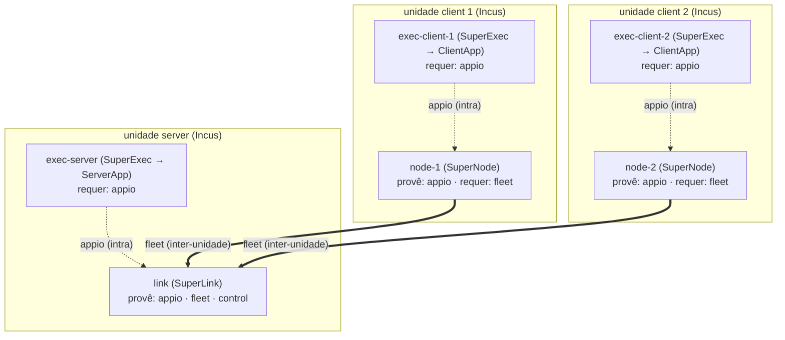

# HPC Shelf — limitações, decisões e fases

Como a camada de federação (Flower + PyHealth) foi levada para a plataforma de
componentes do orientador (`hpcshelf-model`): o que a plataforma **impõe**, o que
**decidimos** por causa disso, e em que **fase** cada coisa aconteceu.

| | |
| --- | --- |
| **Este documento** | Limitações da plataforma, decisões tomadas e o estado de cada fase |
| **Resultados** | [`HPC_SHELF_RESULTS.md`](HPC_SHELF_RESULTS.md) — números e evidências (comando + saída) |
| **Como executar** | [`HPC_SHELF_WORKLOAD_GUIDE.md`](HPC_SHELF_WORKLOAD_GUIDE.md) — mapa de arquivos e loop de validação |
| **Pedido ao orientador** | [`HPC_SHELF_ORIENTADOR_REQUEST.md`](HPC_SHELF_ORIENTADOR_REQUEST.md) — o que falta para publicar e o conceito que pedimos |
| **Base de referência** | `hpcshelf-model`, branch `develop`, commit `68f0ace62160191f082ee783601c48b9fb3f85f1` |
| **Escopo** | Camada de federação — o workload Flower + PyHealth. Provisionamento de infraestrutura fica fora |

> Nada aqui autoriza deploy, build ou push. É desenho e decisão.

## 1. Enquadramento: plataforma e carga de trabalho

O `hpcshelf-model` é a **plataforma**: orquestra componentes distribuídos e
recursivos (Incus na raiz → Podman aninhado), com catálogo versionado, VPN, mTLS,
planejamento de placement e injeção de dependências. O exemplo validado
(`client-server-two-host:1.4`) é um *hello-world* gRPC.

O **nosso** projeto (Flower + PyHealth) é a **carga de trabalho** que roda sobre
ela. O `flower_app/` (ServerApp, ClientApp, `task.py`, `model.py`,
`strategies.py`, `privacy.py`, `explain.py`) **não muda**: vira o conteúdo das
imagens de unidade.

O que a plataforma **substitui** no nosso repositório:

| Hoje | Passa a ser |
| --- | --- |
| `podman-compose.yml` (SuperLink + 2 SuperNode + 3 SuperExec, 1 máquina) | descritores `Component` / `Application` do HPC Shelf |
| `scripts/deploy_containers.sh` | orquestrador do HPC Shelf (`hpcshelf_client.py`) |
| `--insecure` + portas publicadas à mão | VPN + mTLS + alocação de portas da plataforma |
| `env/incus/*` (template manual) | unidade Incus materializada pelo HostAgent |

## 2. Limitações da plataforma que condicionam o desenho

Levantadas lendo o código da plataforma. São elas que decidem a decomposição.

| # | Restrição | Evidência |
| --- | --- | --- |
| **R1** | Unidade raiz usa runtime `incus` e não tem `parent_unit_id`; unidade aninhada usa `podman` e tem `parent_unit_id` = pai imediato | `deployment_planner.py` (atribuição `runtime_type`) |
| **R2** | É permitido aninhar Podman **direto** numa unidade raiz Incus; o exemplo usa um intermediário só para demonstrar aninhamento transitivo | `AGENTS.md`; `podman-unit-base/entrypoint.sh` (o UnitAgent é PID 1 e cria os filhos Podman) |
| **R3** | Dependência horizontal resolve **apenas dentro do mesmo `component_path`** | `deployment_planner.py::_resolve_dependencies`; o validador reforça com **C002 / UNKNOWN_DEPENDENCY_UNIT** (`semantic_validator.py::_validate_dependencies`) |
| **R4** | A dependência injeta `host = service.vpn_address` e `port = service.published_port` no ambiente da unidade de origem | `deployment_planner.py::_resolve_dependencies` |
| **R5** | Binding de réplica: `origem[i] → alvo[i]`, com fallback para `alvo[0]` | `deployment_planner.py::_select_dependency_target` |
| **R6** | Dentro de **uma** composição aninhada, cada `(hostUnit, hostReplica)` comporta **no máximo uma** réplica interna. Composições aninhadas **separadas** têm escopos de ocupação independentes | `semantic_validator.py` — `occupied_host_replicas` é reiniciado por `nestedComponents`; código **C017 / HOST_REPLICA_OVERLAP_COLLISION** |
| **R7** | Toda unidade do componente filho precisa de um mapeamento em `overlap` | `semantic_validator.py` — **C007 / INCOMPLETE_OVERLAP** |
| **R8** | `placement` só pode referenciar unidades **raiz** | `semantic_validator.py` — **D004 / NON_ROOT_UNIT_PLACEMENT** |
| **R9** | Cada unidade executa **um único** `application_command`, lançado pelo `ApplicationManager` como subprocesso do UnitAgent | `unitagent/application_manager.py`; `deployment_model.py::UnitInstancePlan.application_command: list[str] \| None` |

**R3 e R6 juntas são a origem da lacuna #2** (seção 5).

## 3. O modelo-alvo lógico

A federação é descrita como **dois componentes**, não como um conjunto de
contêineres:

| Componente | Unidade | Processo | Provê | Requer |
| --- | --- | --- | --- | --- |
| **comunicação** | `link` (server) | `SuperLink` | `appio`, `fleet`, `control` | — |
| | `node` ×N (client) | `SuperNode` | `appio` | `fleet` |
| **exec** | `exec-server` (server) | `SuperExec` → ServerApp | — | `appio` |
| | `exec-client` ×N (client) | `SuperExec` → ClientApp | — | `appio` |

Ligações: `exec-server → link` e `exec-client → node` são **intra-unidade**;
`node → link` (`fleet`) é a **única** que cruza unidade.

**Distinção que governa tudo:** o modelo acima é **lógico** (quem é unidade de
quem, quem provê o quê). A **realização física** na HPC Shelf não é única — é o
que a seção 4 detalha.

## 4. Os três braços

O modelo lógico é um só. Como **realizá-lo** em unidades físicas não é: a
plataforma deixa aninhar componentes, e o resultado depende de **quantos
processos Flower dividem um contêiner** e de **quem é filho de quem**. O projeto
estuda **três realizações** — os *braços* — porque a escolha entre elas é
justamente o que a lacuna #2 (seção 5) força, e o custo de cada uma é medido, não
argumentado.

| Braço | O que é | Unidades | `appio` (9091/9094) | Estado |
| --- | --- | :---: | --- | --- |
| **1. agrupado** | um contêiner por instituição | 6 | loopback dentro do contêiner | **default**, construído |
| **2. 3 níveis** | um processo por contêiner, aninhado | 9 | **publicado na VPN** | construído e medido |
| **3. 3 níveis + `scope: parent`** | igual ao 2, mas `appio` só no pai | 9 | só no namespace do pai | **bloqueado na plataforma** |

### Braço 1 — `agrupado` (default)

Cada instituição é **uma** unidade Podman que roda os seus dois processos por um
script supervisor (R9 só permite um `application_command`):

- `hub` = `SuperLink` + `SuperExec ServerApp`;
- `hospital` = `SuperNode` + `SuperExec ClientApp`.

Como o `SuperExec` e o `SuperLink`/`SuperNode` vivem no **mesmo contêiner**, o
`appio` nunca sai do loopback: `9091` e `9094` são `127.0.0.1` de dentro. A
**única** porta declarada como serviço é `fleet` (`9092`), que é o que cruza a
fronteira da instituição.

- **A favor:** superfície de rede mínima (uma porta publicada); nenhuma mudança
  na plataforma; satisfaz R3 e R6 ao mesmo tempo sem tocar em invariante.
- **Contra:** dois processos por contêiner (o `SuperExec` efêmero compartilha
  ciclo de vida com o processo de longa duração); a imagem de transporte carrega
  o corpus e a stack de ML junto (é a mesma imagem do app).
- **Artefato:** `env/hpcshelf/arms/grouped/`.

### Braço 2 — `3 níveis`

Um processo por contêiner, com aninhamento **transitivo** (o que o agrupado
recusa): `institution` (Incus) → `exec-*` (Podman, o `SuperExec`) → `link`/`node`
(Podman, o `SuperLink`/`SuperNode`) — nove unidades em três níveis. É a forma que
o modelo lógico "pede": o `SuperExec` (o app, com os dados) **hospeda** o
transporte que ele usa.

- **A favor:** um processo por unidade; a unidade de transporte (`link`/`node`)
  **não contém** `data/`, `flower_app`, torch nem PyHealth — quem carrega
  parâmetros não consegue ler um registro. É o ganho de menor privilégio.
- **Contra:** para o pai descobrir a porta do filho, o `appio` precisa ser
  **declarado como serviço** — e o publicador da plataforma é recursivo e não
  filtra, então o `appio` sobe para o endereço VPN, alcançável por qualquer host.
  Além disso, uma federação inteira num só host deixa de ser expressável (um host
  = um papel).
- **Artefato:** `env/hpcshelf/arms/three-level/`.

### Braço 3 — `3 níveis + scope: parent`

Idêntico ao braço 2, com **uma** diferença: o `appio` é declarado como serviço
**interno**, visível apenas para o pai imediato. Não muda o número de unidades
nem o aninhamento — muda só onde o `appio` fica alcançável.

Seria a realização que fica com as **duas** propriedades ao mesmo tempo
(isolamento do braço 2 **e** superfície mínima do braço 1), e é a que **fecha ou
reafirma a Fase 3**. Está bloqueado porque `ServiceDefinition` não tem campo de
escopo (`scope: parent`) — é o pedido da Parte 3 em
[`HPC_SHELF_ORIENTADOR_REQUEST.md`](HPC_SHELF_ORIENTADOR_REQUEST.md).

### Por que três, e não um

O braço 1 é o default por uma razão de privacidade: ele mantém o `appio` em
loopback. O braço 2 mede o que **custaria** separar (o `appio` na VPN) e mostra,
no artefato, o que a separação **compra** (transporte sem dados). O braço 3 é a
prova de que o custo do braço 2 é uma **limitação da plataforma**, não uma
propriedade do desenho: com `scope: parent`, a separação deixa de ser um trade e
passa a ser escolha de conveniência. Enquanto o conceito não existir, o default
fica no braço 1.

## 5. A lacuna #2: por que o braço 1 é o default

Um hospital, na visão do Flower, não é um processo só: é um `SuperNode` **mais**
um `SuperExec ClientApp`. O hub é um `SuperLink` **mais** um `SuperExec ServerApp`.
Ou seja, cada instituição precisa de **duas** unidades Podman dentro da sua
unidade Incus — e a plataforma não permite isso quando as duas precisam conversar:

- **R3** diz que uma dependência só resolve dentro do **mesmo componente**. Logo,
  para `SuperNode → SuperLink` e `ClientApp → SuperNode` funcionarem, as quatro
  unidades têm que estar **no mesmo componente**.
- **R6** diz que, **numa** composição aninhada, cada réplica de host comporta
  **uma** réplica interna. Logo, `hub[0]` não pode hospedar `superlink` **e**
  `serverapp`.

As duas saídas óbvias se anulam:

| Caminho | Co-localizar | Dependência | Resultado |
| --- | :---: | :---: | --- |
| Mesmo componente | ✗ (R6/C017) | ✓ (R3) | inválido |
| Composições separadas | ✓ (R6) | ✗ (R3) | inválido |

### Opções avaliadas

**A. Uma unidade Podman por instituição (bundle) — ESCOLHIDA.** É o braço 1.
Zero mudança na plataforma; usa só mecânica já validada no exemplo; as duas
unidades ficam no mesmo componente (R3 satisfeita); elimina a classe de bug de
sincronia de portas AppIO; uma porta publicada só. Custo: ciclo de vida
compartilhado e scripts supervisores.

**B. Composições separadas + dependência inter-componente (evolução da plataforma).**
Manter quatro contêineres, um por processo, e estender a plataforma para resolver
dependência entre componentes. Preserva a topologia nativa do Flower, mas muda a
plataforma do orientador e bloqueia as fases seguintes até a mudança existir.

**C. Intermediário Podman-in-Podman (espelhar o exemplo literalmente).** Na época
rejeitada como "não resolve"; a conclusão era imprecisa. O aninhamento transitivo
é **expressável** e foi depois construído como o braço 2. O custo real dessa
separação não é "não resolve", é que ela **publica o `appio` na VPN** — a
plataforma não tem `scope: parent`.

**D. Relaxar C017** (permitir N réplicas internas por réplica de host na mesma
composição). Rejeitada: é um invariante validado da plataforma, e o `AGENTS.md`
do `hpcshelf-model` proíbe mudar invariantes para fazer um caso passar.

**E. Uma unidade Incus por processo.** Viável no modelo, mas destrói a fronteira
"um Incus = uma instituição", que é a fronteira de dados do projeto. Rejeitada.

### Decisão

**Adotamos a opção A (braço 1).** Um contêiner por instituição: `hub` e
`hospital`, ambos no componente `flower-federation`, sobre os hosts Incus
`institution[*]`. É a única opção que satisfaz R3 e R6 simultaneamente **sem
alterar a plataforma**. Reversível: se a opção B for aceita depois, migramos para
quatro contêineres mudando **descritores e entrypoints**, sem tocar no
`flower_app/`.

### Consequências

Positivas: só uma porta cruza a fronteira do hospital (`9092`); some a classe de
falha "SuperNode escuta numa porta que o SuperExec não disca"; o `partition-id`
(lacuna #1) passa a vir do plano da unidade.

Negativas / a mitigar: `SuperExec` e `SuperLink`/`SuperNode` compartilham ciclo de
vida (o supervisor reinicia o `SuperExec` sem derrubar o outro); perde-se
isolamento de processo por componente Flower; a imagem empacota dois papéis.

### Reabertura da leitura (2026-10-03)

O raciocínio original tratava o trade como binário: ou o `appio` cruza fronteira
de contêiner (violando o invariante `M103`), ou se agrupa. Dois fatos apurados
depois mostram que há terceira via — o braço 3:

1. **O endereçamento vertical já existe.** `_collect_forwarded_services` mantém a
   `published_port` constante por todos os níveis, e o pai alcança o serviço do
   filho no próprio namespace, lendo o próprio plano (`UnitPlan.children`).
2. **Mas o publicador não filtra.** `hostagent/endpoint_publisher.build_publications`
   é recursivo: todo serviço de todo descendente sobe para o endereço VPN. É
   **isso**, e não a fronteira de contêiner em si, que o invariante protege.

**Leitura corrigida:** `M103` ("`appio` não cruza fronteira") é um **proxy** do
invariante real ("`appio` não alcançável além do seu pai imediato"). Enquanto a
plataforma não souber declarar serviço interno, o proxy é exato — e é por isso
que o braço 1 funcionava. Com `scope: parent`, o proxy deixa de ser necessário.
O raciocínio original fica preservado: se o conceito for recusado, a decisão de
2026-09-25 volta a valer como estava.

## 6. O pedido de plataforma: `scope: parent`

A única mudança de plataforma que ainda pedimos. Ela não é necessária para o que
funciona — é o que dissolve o trade forçado entre os braços 1 e 2.

**O pedido.** Uma forma de declarar serviço **interno** (`scope: parent`, ou outro
nome), honrada em dois pontos: `EndpointPublisher` **não o publica**, e
`_collect_forwarded_services` mantém o encaminhamento **apenas até o pai
imediato**.

| | agrupado (braço 1) | 3 níveis (braço 2) | 3 níveis + `scope: parent` (braço 3) |
| --- | :---: | :---: | :---: |
| `appio` só no namespace do pai | ✅ | ❌ | ✅ |
| Aninhamento `SuperExec → link`/`node` | ❌ | ✅ | ✅ |
| `appio` no endereço VPN | não | **sim** | **não** |

**Por que importa.** O `appio` não carrega só tarefas: em Flower, as atualizações
de peso viajam `SuperExec → SuperNode` pelo AppIO e só depois pelo `fleet`.
Publicá-lo no endereço VPN deixa o canal de peso alcançável por qualquer host
participante. O detalhamento e o código medido estão na Parte 3 de
[`HPC_SHELF_ORIENTADOR_REQUEST.md`](HPC_SHELF_ORIENTADOR_REQUEST.md).

**Impacto da mudança:** aditivo (campo no modelo + filtro no publicador +
testes). Não altera invariante existente nem cenário já validado.

## 7. Requisitos derivados

O que a construção das imagens confirmou na prática:

1. **As imagens são construídas sobre a imagem de aplicação do projeto**, e não
   `FROM podman-unit-base`. Dois motivos: a base da plataforma não tem Flower,
   PyHealth nem Torch; e o venv da aplicação precisa de protobuf 6.x enquanto o
   UnitAgent precisa de 7.x. O bootstrap da plataforma (`/opt/hpcshelf`) é copiado
   da base.
   > **Atualizado em 2026-10-03.** O piso do projeto desceu de `>=3.13` para
   > `>=3.12`. A incompatibilidade de versão do Python **deixou de ser um motivo**.
   > Consequência: `FROM podman-unit-base` volta a ser base viável para as imagens
   > de **nível do meio** do braço 2, que precisam aninhar Podman.
2. **A imagem carrega dois interpretadores, e isso é obrigatório.** Os `*_pb2.py`
   da plataforma foram gerados com gencode **7.35.1**; o Flower 1.34 depende de
   runtime **6.x**. Carregar um no outro falha com `VersionError`. O venv do
   UnitAgent é **recriado**, não copiado (virtualenv não é relocável).
3. **Um único `application_command` por unidade (R9)** é o que obriga os
   supervisores e o agrupamento do braço 1.
4. **Identidade por réplica não se configura.** Vem do plano da unidade
   (`plan.replica`), lido pelo supervisor. Um binding de descritor é compartilhado
   por todas as réplicas e daria a mesma partição a todos.
5. **As unidades do braço 1 são folhas** (`HPCSHELF_PODMAN_RUNTIME=mock`): não
   hospedam filho Podman. No braço 2, o nível do meio é que aninha.
6. **Nada de bind-mount de host.** Dados dentro do storage da unidade.
7. **A imagem roda como root**, seguindo a base da plataforma — item de
   endurecimento, não decisão de desenho (Fase 7).

## 8. Pendências registradas (não decididas aqui)

| Lacuna | Descrição | Fase |
| --- | --- | --- |
| #1 | ~~`partition-id` por réplica~~ **Resolvido.** O `UnitPlan` da unidade já carrega `replica`, e o UnitAgent injeta `HPCSHELF_UNIT_PLAN` para toda unidade, raiz e aninhada. Nenhum patch é necessário; o pedido de `UNIT_REPLICA_ID` foi retirado. | concluído |
| #2 | Co-localização de unidades Podman. **Contornada** pelo braço 1; **resolvida de verdade** só com `scope: parent` (braço 3). | 3 |
| #3 | TLS em duas camadas. A plataforma tem mTLS no plano de controle e VPN no de dados; o Flower tem TLS próprio. Alinhar e remover `--insecure`. | 5 |
| #4 | Colocação de dados. MIMIC demo pode ir embutido; **SESA-CE nunca entra em imagem** — injeção segura na unidade do hospital. | 5–6 |
| #5 | Registry/catálogo. `registry:2` (porta 5000) assume o papel de catálogo. A publicação depende de credenciais e caminho de projeto no registry da plataforma, além do digest de `hpcshelf-unit-base`. | 2 (gate) |
| #6 | DP central e ausência de agregação segura. A plataforma resolve transporte; não resolve SecAgg. | futuro |

## 9. Fases

Cada fase tem objetivo, artefato verificável e critério de saída, e só começa
quando a anterior fecha. Os **números** de cada fase estão em
[`HPC_SHELF_RESULTS.md`](HPC_SHELF_RESULTS.md).

**Fase 0 — Reconciliação (GATE).** Decidir qual artefato é a base da
implementação. **Decisão: opção 0-C** — o modelo lógico (seção 3) vira referência
versionada, e os dois artefatos (`env/hpcshelf/` e o catálogo da plataforma) são
verificados como **conformes** a ele. Executada em 2026-09-25.

**Fase 1 — Congelar o modelo lógico.** Satisfeita pela própria 0-C: modelo
escrito, diagrama Mermaid em `docs/ARCHITECTURE.md` §2.1, distinção lógico ×
físico registrada. Extra não previsto: o modelo ficou **verificável**, não só
escrito (`python -m libs.federation_components`).

**Fase 2 — Identidade por réplica (lacuna #1).** Cada unidade descobre *qual*
réplica é, sem literal no descritor e sem adivinhar. **Resolvido** lendo
`plan.replica` do `HPCSHELF_UNIT_PLAN`; o patch `0001-unit-identity-environment`
foi retirado do pedido e depois removido da árvore (proveniência no histórico
git). Resolvido em 2026-09-25.

**Fase 3 — Descritores do modelo-alvo.** Expressar o modelo em descritores e
provar o que a plataforma aceita e recusa. **Concluída em 2026-09-25**, decisão:
o invariante vale no nível do **contêiner** (`appio` não cruza fronteira), logo o
braço 1 deixa de ser concessão e passa a ser **propriedade defendida**.
**Reaberta em 2026-10-03**: o braço 2 mostra que a separação é expressável, e o
braço 3 (`scope: parent`) é o que fecharia a fase. Ver seção 5.

**Fase 4 — Imagens das unidades.** Manter as imagens do braço 1 e transformar em
verificação as invariantes que eram prosa. Concluída em 2026-09-25.

**Fase 5 — Prova.** Baseline verde com controles negativos. Concluída em
2026-09-25. Ressalva permanente: a prova é de fiação, registro e álgebra da
agregação — **não** de um round federado de ponta a ponta.

**Fase 6 — Run federado completo.** Observar um round agregar de verdade na
plataforma. **Bloqueada** por: material mTLS, Incus + HostAgent no host, e os
bytes da imagem base do root (501 MB, só no catálogo do orientador). Nenhum dos
três é autorização de escrita no catálogo dele.

**Fase 7 — Governança.** TLS alinhado, dados da SESA-CE só por injeção na
unidade, ε declarado no manifesto quando `dp-mode != none`. Bloqueada pela Fase 6.

## 10. Regras para não pular fases

1. **Uma fase por vez.** Toda fase deixa evidência executável (comando + saída),
   não opinião.
2. **Nunca declarar mais do que a prova estabelece.** As ressalvas "a prova não
   estabelece que isso implanta" e "nenhum round federado completo ainda" só caem
   quando a Fase 6 fechar.
3. **Controle negativo junto do positivo.** Um validador verde é indistinguível
   de um validador que não verifica nada.
4. **Nada de dado de paciente** em imagem, log ou commit. Ver
   [`DATA_GOVERNANCE.md`](DATA_GOVERNANCE.md).
5. **Se uma fase revelar que o desenho está errado, corrigir o desenho aqui
   antes de continuar** — foi o que aconteceu com a opção C da seção 5.

## Referências

- [`HPC_SHELF_RESULTS.md`](HPC_SHELF_RESULTS.md) — números e evidências.
- [`HPC_SHELF_WORKLOAD_GUIDE.md`](HPC_SHELF_WORKLOAD_GUIDE.md) — como executar.
- [`HPC_SHELF_ORIENTADOR_REQUEST.md`](HPC_SHELF_ORIENTADOR_REQUEST.md) — o pedido.
- [`ARCHITECTURE.md`](ARCHITECTURE.md) — topologia da camada de federação.
- `hpcshelf-model` — `AGENTS.md` (invariantes), `deployment_planner.py`,
  `semantic_validator.py`, `unitagent/application_manager.py`.
- McMahan et al., *Communication-Efficient Learning of Deep Networks from
  Decentralized Data*, AISTATS 2017 — FedAvg, baseline do `strategies.py`.
- Li et al., *Federated Optimization in Heterogeneous Networks*, MLSys 2020 —
  FedProx, o termo proximal do `model.py`.
