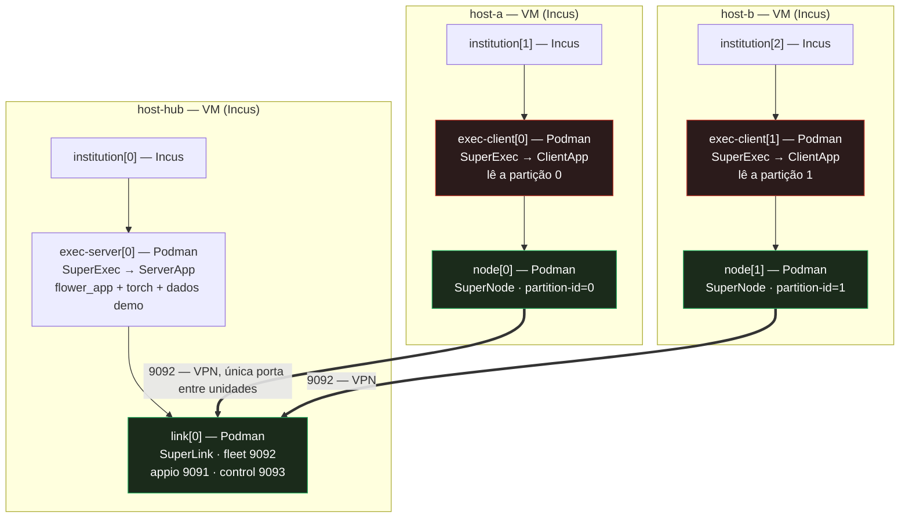

# HPC Shelf — plano de execução do braço 2 no GCP

| | |
| --- | --- |
| **Status** | **Plano. Nada foi executado.** Nenhuma VM, nenhum deploy, nenhuma publicação. |
| **Alvo** | `env/hpcshelf/arms/three-level/` (braço 2) sobre a plataforma HPC Shelf, em VMs no GCP |
| **Escopo** | Camada de federação: o que provisionar, o que publicar, em que ordem, a que custo |
| **Fora de escopo** | Provisionamento de infraestrutura pelo repositório, escrita no catálogo da plataforma, código da plataforma |
| **Provas que este plano usa** | [`HPC_SHELF_RESULTS.md`](HPC_SHELF_RESULTS.md) · [`HPC_SHELF_DECISIONS.md`](HPC_SHELF_DECISIONS.md) |
| **Como executar cada passo** | [`HPC_SHELF_WORKLOAD_GUIDE.md`](HPC_SHELF_WORKLOAD_GUIDE.md) |

> **Regra deste documento.** Ele separa três coisas que é fácil confundir:
> o que **a plataforma já provou no GCP**, o que **este repositório já provou
> offline**, e o que **ninguém provou ainda**. A terceira lista é a maior.

## 1. Por que o GCP, e por que não é especulativo

A plataforma já executou uma topologia de **3 níveis** no GCP. O exemplo
`client-server-two-host:1.4` é `a` (Incus) → `intermediate` (Podman) →
`client-server` (Podman): **2 raízes e 4 descendentes Podman**, com importação
automática de imagem, RPC horizontal e teardown completo, aceitos em
2026-09-13. Fonte: `deploy/phase8-parallel/COLD_CACHE_ACCEPTANCE.md` e
`RUNBOOK.md` no clone da plataforma.

**O caminho já foi andado.** O que falta é adaptá-lo à *nossa* carga, que difere
em duas coisas: ela roda ML de verdade, e ela tem um braço a mais de unidades.

## 2. O ambiente que já existe

Do runbook da plataforma — **recursos protegidos, não recrear**:

| Recurso | Valor |
| --- | --- |
| Projeto GCP | `fapesp-uece-ufc-2023-00744-1` |
| host-hub / host-a | VM `client-unit`, zona `us-east4-c` |
| host-b | VM `server-unit`, zona `us-east4-a` |
| Catálogo | VM `component-catalog`, `us-east4-c`, `https://catalog.hpcshelf.org` |
| HostAgent | TCP 50062 (o ensaio cold-cache usou 50064) |
| Incus | projeto e pool **por ensaio** (`dir`), independentes |
| Rede da aplicação | base 10.252.0.0/23, prefixo /24 |
| Portas publicadas | 31000–31100 |
| WireGuard | UDP 51822 |
| Instalação | `/opt/hpcshelf-phase8/releases/<bundle-sha256>/`, venv por release |
| Imagem raiz | `a17c7d8d…`, 501 MB, entregue pelo arquivo HTTPS |

E os orçamentos de tempo já calibrados pela plataforma:

```text
HPCSHELF_UNITAGENT_TIMEOUT=600              # RPC HostAgent -> UnitAgent raiz
HPCSHELF_PODMAN_IMAGE_PULL_TIMEOUT=600      # inatividade de leitura no pull
recursive readiness: 1800 tentativas x 1 s  # não é limite de tempo de parede
Orchestrator -> HostAgent RPC: 2100 s
```

## 3. O que muda no nosso braço

| | Exemplo 1.4 (provado) | Braço 2 (nosso) |
| --- | --- | --- |
| Unidades | 2 raízes + 4 aninhadas | **3 raízes + 6 aninhadas** |
| Instituições | 2 | **3** (1 servidor + 2 hospitais) |
| Imagens | minúsculas (*hello-world* gRPC) | **~17,8 GB** (7,8 + 7,8 + 1,08 + 1,08) |
| Carga | `getValue`/`setValue` | **torch + PyHealth** dentro das unidades |
| Porta que cruza | 9092 | 9092 (igual) |

As duas últimas linhas são o risco real: **a plataforma nunca rodou ML dentro
dessas unidades aninhadas**, e nunca puxou uma imagem de 7,8 GB.

## 4. Topologia a implantar



Os dois nós vermelhos são as únicas unidades que leem prontuário. Os três verdes
são transporte puro — **1,08 GB, sem `data/`, sem torch, sem pyhealth,
sem `flower_app`** — e há um guarda de papéis no build que prova isso (9/9).

## 5. Quantas VMs: 2 ou 3? (medido, não argumentado)

Pergunta que decide o custo. Rodado com o planner da plataforma sobre o catálogo
publicado, offline (`build/hpcshelf-catalog-three-level`):

| Configuração | Resultado |
| --- | --- |
| **3 VMs** — uma instituição cada | **ACEITO** — 9 unidades, 3 hosts distintos |
| **2 VMs** — `institution[1]` e `institution[2]` no mesmo host | **ACEITO** — 9 unidades, 2 hosts distintos |

Ou seja: **duas instituições no mesmo host são expressáveis.** O `C017` não
dispara, porque cada `institution` é uma raiz separada com composição aninhada
própria — os escopos de ocupação são independentes.

E é exatamente por isso que a resposta certa é **3 VMs**:

> Com 2 VMs, `exec-client[0]` e `exec-client[1]` — os dois únicos processos que
> leem prontuário — rodam na **mesma máquina física**. A partição do hospital A e
> a do hospital B passam a ter o mesmo dono administrativo, com um único
> hipervisor entre elas. Isso não é "federado com menos nós": é a propriedade que
> o braço existe para demonstrar, desfeita para economizar uma VM.

O ganho da separação é **contenção de dano**, e contenção de dano não sobrevive a
compartilhar o host. **Decisão proposta: 3 VMs.** A linha de 2 VMs fica registrada
porque é o caminho de emergência se a cota ou o orçamento não permitirem 3.

## 6. Requisitos por VM

| Item | Requisito | Observação |
| --- | --- | --- |
| Incus | instalado, pool `dir`, **`security.nesting`** | a raiz Incus aninha Podman; o `exec` aninha de novo |
| Virtualização aninhada | **NÃO é necessária** | é imagem de **contêiner** Incus, não VM. Não pedir `/dev/kvm` nem machine type que o exija |
| Disco | **≥ 40 GB** por host, sendo ≥ 25 GB livres antes do run | a plataforma exige ≥ 10 GB livres para imagens pequenas; aqui são ~8,9 GB por host só de imagem, mais desempacotamento |
| CPU / RAM | 8 vCPU / 32 GB por host, como ponto de partida | o exemplo 1.4 não rodava ML; isto é estimativa, não medição |
| GPU | **nenhuma** | o treino local no protótipo é pequeno; GPU é decisão separada, com `nvidia-container-toolkit` |
| Timeouts | subir `HPCSHELF_PODMAN_IMAGE_PULL_TIMEOUT` acima de 600 s | 7,8 GB por pull contra um limite calibrado para imagens de megabytes |
| HostAgent | um por host, com CA/cert/chave | a plataforma traz o agente; instalação é passo de operador |

## 7. Rede e firewall

| Porta | Uso | Escopo |
| --- | --- | --- |
| UDP `vpnListenPort` (ex. 51822) | WireGuard — plano de dados da aplicação | **aberta entre as VMs** |
| TCP do HostAgent (ex. 50062) | plano de controle, gRPC + mTLS | operador → VMs |
| TCP 443 | catálogo HTTPS + registry OCI + arquivo Incus | VMs → catálogo |
| `fleet` 9092 | SuperNode → SuperLink | **dentro da VPN**, nunca na firewall do GCP |
| `appio` 9091 / 9094 | Runtime API | **na VPN** — é o custo do braço 2 (ver §9) |
| `control` 9093 | submissão de run | **não publicado** por decisão (ver §9) |

Duas armadilhas do runbook que valem repetir aqui: os **metadados WireGuard
públicos vêm do HostAgent autenticado** — não se inventa chave nem se copia IP de
log antigo; e o endereço de controle **não é** necessariamente o endpoint público
da VPN.

## 8. Ordem de execução

Nada abaixo está feito. A ordem importa: os passos 1–4 são **offline e gratuitos**,
e é onde qualquer erro deve aparecer.

```text
PRÉ-REQUISITOS (offline, sem GCP)
 1. Publicar os 3 componentes no catálogo ................. ensaiado 31/31; falta o destino
 2. Publicar as 4 imagens no registry do catálogo ......... ~17,8 GB de upload
 3. Montar o catálogo candidato e validar ................. validate_release.py contra snapshot confiável
 4. Inventariar os hosts (real, privado) .................. id/address/VPN por host

PROVISIONAMENTO (com autorização do operador)
 5. Terceira VM (host-b) na mesma região .................. ou reusar `server-unit`, conforme §5
 6. Instalar Incus + HostAgent, projeto e pool novos ...... seguir RUNBOOK.md da plataforma
 7. Ler os metadados VPN do HostAgent autenticado ......... preencher o inventário do passo 4

PLANO E EXECUÇÃO (read-only até o deploy)
 8. validate -> plan ..................................... inspecionar 9 unidades, pais, bindings, endpoints
 9. preflight ............................................ exige mTLS; para antes de tocar a rede
10. deploy (autorizado) .................................. 3 raízes Incus + 6 Podman
11. Verificar e depois teardown .......................... inspecionar ausência de resíduos
```

O passo 10 **não** produz um round federado — ver §9.

## 9. As duas rotas para um round de verdade

Um deploy bem-sucedido deixa 9 unidades de pé e os SuperNodes registrados no
`link`. **A agregação não começa**, porque `flwr run` não tem ponto de entrada: o
Control API (9093) não é declarado em nenhum braço. É o bloqueio da Fase 6.

| | Rota A — `scope: parent` | Rota B — declarar `control` |
| --- | --- | --- |
| O que muda | campo novo no `ServiceDefinition` (plataforma) | 2 linhas no descritor `comunicacao` + `supervise-exec.sh` |
| Quem submete | o pai `exec-server`, lendo a porta do próprio plano | o pai `exec-server`, pelo mesmo mecanismo do `appio` |
| Exposição do 9093 | **nenhuma** | **publicado na VPN** |
| Custo | acordo com o orientador | aceitar a superfície durante o experimento |
| Serve para produção | sim | **não** |

A rota A é a correta e é o pedido registrado em
[`HPC_SHELF_ORIENTADOR_REQUEST.md`](HPC_SHELF_ORIENTADOR_REQUEST.md). A rota B é
um artifício de experimento: ela funciona, e é honesta desde que o resultado seja
rotulado como obtido com o 9093 exposto.

**Consequência para o plano:** se o objetivo do deploy no GCP é *ver o round
fechar*, então o passo 1 precisa incluir a decisão da §9 — caso contrário o
deploy prova só a topologia, que já está provada offline (39/39 + 22/22).

## 10. Custo

| Item | Estimativa | Nota |
| --- | --- | --- |
| Upload das imagens | **~17,8 GB** | da estação de trabalho (aqui) para o registry. É banda local, não fatura GCP |
| Transferência entre VMs | ~19 GB no total | colocar o registry **na mesma região** mantém isso dentro do GCP |
| Armazenamento no registry | ~12–13 GB | as camadas são compartilhadas entre os pares de imagem |
| VMs | 3 instâncias, por hora | 8 vCPU / 32 GB como ponto de partida |
| Contexto | o runbook da plataforma registra que a verba provisória de **US$ 10** permaneceu como *verba*, não como conta medida | o custo real não foi reconciliado contra o faturamento |

Os recursos existentes **são protegidos**: o runbook proíbe explicitamente
remover imagens compartilhadas, mexer no projeto/pool default do Incus ou
reiniciar agentes antigos. O `teardown` remove a aplicação, não o ambiente.

## 11. O que este plano NÃO estabelece

- **Não estabelece que o braço 2 já implantou.** Nada foi executado.
- **Não estabelece que o GCP aguenta a nossa carga.** O que a plataforma provou
  no GCP foi uma carga *hello-world*; torch + PyHealth em três níveis aninhados,
  com imagens de 7,8 GB, é território novo.
- **Não estabelece um round federado.** Ver §9.
- **Não inclui SESA-CE.** As imagens só carregam o MIMIC-IV demo, e só nas
  unidades `exec`. Dado real entra por injeção na unidade, nunca por imagem —
  ver [`DATA_GOVERNANCE.md`](DATA_GOVERNANCE.md).
- **Não resolve TLS.** Todo supervisor roda `--insecure`; a VPN é o único
  argumento de confidencialidade até hoje.

## 12. Decisões que dependem do orientador

1. **3 VMs ou 2.** §5 mede as duas; a recomendação é 3, e a diferença é a
   propriedade de segurança do braço.
2. **Destino da publicação.** Credenciais de escrita no registry, caminho de
   projeto confirmado, e confirmação da base 1.4 — as três de
   `HPC_SHELF_ORIENTADOR_REQUEST.md`.
3. **Qual rota da §9.** Sem isso o deploy no GCP demonstra topologia, não
   federação.
4. **Autorização de escopo** para criar/reusar VMs e para publicar. O runbook da
   plataforma é explícito que escrita em registry e start de VM exigem escopo
   aprovado pelo operador.
