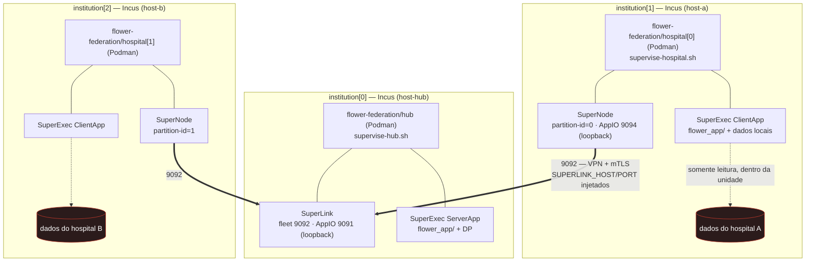

# Integração com o HPC Shelf

**Fase 0 — decomposição de componentes congelada e decisão sobre co-localização de unidades**

| | |
| --- | --- |
| Status | Fases 0, 1, 2 e o caminho de publicação concluídos; **nada publicado no catálogo da plataforma nem implantado** |
| Prova de desenho | `scripts/validate_hpcshelf.sh` — 25 verificações, 0 falhas |
| Prova funcional | `scripts/smoke_hpcshelf_images.sh` — 8 verificações, 0 falhas |
| Ensaio de publicação | `scripts/publish_hpcshelf_images.sh` — 18 verificações, 0 falhas |
| Base de referência | `hpcshelf-model`, branch `develop`, commit `68f0ace62160191f082ee783601c48b9fb3f85f1` |
| Escopo do documento | Camada de federação (o workload Flower+PyHealth) |
| Fora de escopo | Provisionamento de infraestrutura, publicação de imagens, código da plataforma |

Este documento é a saída da Fase 0 do plano de integração. Ele **congela** a
decomposição de componentes que as fases seguintes vão implementar e **registra a
decisão** sobre a lacuna #2 (co-localizar várias unidades Podman dentro de uma
unidade Incus), incluindo a limitação da plataforma que a motivou.

> Nada aqui autoriza deploy, build ou push. É desenho.

## 1. Enquadramento: plataforma e carga de trabalho

O `hpcshelf-model` é a **plataforma**: orquestra componentes distribuídos e
recursivos (Incus na raiz → Podman aninhado), com catálogo versionado, VPN,
mTLS, planejamento de placement e injeção de dependências. O exemplo validado
(`client-server-two-host:1.4`) é um *hello-world* gRPC.

O **nosso** projeto (Flower + PyHealth) é a **carga de trabalho** que roda sobre
ela. O `flower_app/` (ServerApp, ClientApp, `task.py`, `model.py`,
`strategies.py`, `privacy.py`, `explain.py`) **não muda**: vira o conteúdo das
imagens de unidade.

O que a plataforma **substitui** no nosso repositório:

| Hoje | Passa a ser |
| --- | --- |
| `podman-compose.yml` (SuperLink + 2 SuperNode + 3 SuperExec, 1 máquina) | descritores `Component` / `Application` do HPC Shelf |
| `scripts/deploy_containers.sh` | orquestrador do HPC Shelf (`hpcshelf_client.py`) |
| `--insecure` + portas publicadas à mão | VPN + mTLS + alocação de portas da plataforma |
| `env/incus/*` (template manual) | unidade Incus materializada pelo HostAgent |

## 2. Restrições da plataforma que condicionam o desenho

Levantadas lendo o código da plataforma. São elas que decidem a decomposição.

| # | Restrição | Evidência |
| --- | --- | --- |
| **R1** | Unidade raiz usa runtime `incus` e não tem `parent_unit_id`; unidade aninhada usa `podman` e tem `parent_unit_id` = pai imediato | `deployment_planner.py` (atribuição `runtime_type`) |
| **R2** | É permitido aninhar Podman **direto** numa unidade raiz Incus; o exemplo usa um intermediário só para demonstrar aninhamento transitivo | `AGENTS.md`; `podman-unit-base/entrypoint.sh` (o UnitAgent é PID 1 e cria os filhos Podman) |
| **R3** | Dependência horizontal resolve **apenas dentro do mesmo `component_path`** | `deployment_planner.py::_resolve_dependencies` — docstring: *"a unit can resolve sibling services only within the same component instance"*; a chave é `(unit.component_path, target.unit)`. O validador reforça o mesmo limite com **C002 / UNKNOWN_DEPENDENCY_UNIT** (`semantic_validator.py::_validate_dependencies`) |
| **R4** | A dependência injeta `host = service.vpn_address` e `port = service.published_port` no ambiente da unidade de origem | `deployment_planner.py::_resolve_dependencies` |
| **R5** | Binding de réplica: `origem[i] → alvo[i]`, com fallback para `alvo[0]` | `deployment_planner.py::_select_dependency_target` |
| **R6** | Dentro de **uma** composição aninhada, cada `(hostUnit, hostReplica)` comporta **no máximo uma** réplica interna. Composições aninhadas **separadas** têm escopos de ocupação independentes | `semantic_validator.py` — `occupied_host_replicas` é reiniciado por `nestedComponents`; código **C017 / HOST_REPLICA_OVERLAP_COLLISION** |
| **R7** | Toda unidade do componente filho precisa de um mapeamento em `overlap` | `semantic_validator.py` — **C007 / INCOMPLETE_OVERLAP** |
| **R8** | `placement` só pode referenciar unidades **raiz** | `semantic_validator.py` — **D004 / NON_ROOT_UNIT_PLACEMENT** |
| **R9** | Cada unidade executa **um único** `application_command`, lançado pelo `ApplicationManager` como subprocesso do UnitAgent | `unitagent/application_manager.py`; `deployment_model.py::UnitInstancePlan.application_command: list[str] \| None` |

**R3 e R6 juntas são a origem da lacuna #2** (seção 4).

## 3. Decomposição congelada

A forma executável desta decomposição está em `env/hpcshelf/` — descritores,
inventário de hosts e o harness que roda o validador e o planner da plataforma.

Duas camadas, sem intermediário (R2 permite):

- **`federation-root`** — componente raiz. Uma unidade Incus, `institution`, com
  uma réplica por host participante (hub + um por hospital).
- **`flower-federation`** — componente folha (Podman). Uma unidade por
  **instituição**, não por processo Flower (ver decisão na seção 4).

### 3.1 Componente raiz `federation-root`

```yaml
apiVersion: hpcshelf.org/v1
kind: Component

metadata:
  name: federation-root
  version: "0.1"

spec:
  units:
    institution:
      image: hpcshelf-unit-base
      replicas: {min: 1, max: 8, default: 3}

  nestedComponents:
    federation:
      component:
        ref: "flower-federation:0.1"

      units:
        hub: {replicas: 1}
        hospital: {replicas: 2}

      overlap:
        hub:
          hostUnit: institution
          mapping:
            type: explicit
            instances:
              - {innerReplica: 0, hostReplica: 0}

        hospital:
          hostUnit: institution
          mapping:
            type: explicit
            instances:
              - {innerReplica: 0, hostReplica: 1}
              - {innerReplica: 1, hostReplica: 2}
```

Ocupação resultante — sem colisão C017 porque cada réplica interna ocupa uma
réplica de host distinta:

```text
institution[0]  ←  hub[0]          (o hub da federação)
institution[1]  ←  hospital[0]     (hospital A)
institution[2]  ←  hospital[1]     (hospital B)
```

### 3.2 Componente folha `flower-federation`

Todas as unidades ficam **no mesmo componente** — condição de R3 para que
`hospital → hub` resolva.

```yaml
apiVersion: hpcshelf.org/v1
kind: Component

metadata:
  name: flower-federation
  version: "0.1"

spec:
  units:
    hub:
      image: catalog.hpcshelf.org/pyhealth/flower-hub:0.1.0

      replicas: {min: 1, max: 1, default: 1}

      application:
        command: [/opt/hpcshelf/supervise-hub.sh]
        environment:
          FLWR_NUM_ROUNDS: "3"
          PYHEALTH_STRATEGY: "fedavg"
          PYHEALTH_DP_MODE: "none"
          PYHEALTH_PROXIMAL_MU: "0.0"

      services:
        fleet:
          protocol: grpc
          containerPort: 9092

    hospital:
      image: catalog.hpcshelf.org/pyhealth/flower-hospital:0.1.0

      replicas: {min: 1, max: 8, default: 2}

      application:
        command: [/opt/hpcshelf/supervise-hospital.sh]
        environment:
          PYHEALTH_PARTITION_SCHEME: "uniform"

      dependencies:
        hub:
          target:
            unit: hub
            service: fleet
          environment:
            host: SUPERLINK_HOST
            port: SUPERLINK_PORT
```

Observações de desenho:

- `fleet` (9092) é a **única** porta que cruza a fronteira da unidade cliente.
  É o único `service` declarado. R4 injeta `SUPERLINK_HOST` (endereço VPN do hub)
  e `SUPERLINK_PORT` (porta publicada do hub) na unidade `hospital`.
- O AppIO do SuperLink (`9091`) é **loopback dentro do container do hub** e não é
  `service`. O AppIO do SuperNode (`9094`) é **loopback dentro do container do
  hospital** e também não é `service`. Isso elimina a classe de bug descrita em
  `docs/DEPLOYMENT.md` ("SuperNode escuta numa porta que o seu SuperExec não
  disca") — não há mais duas portas AppIO distintas para manter em sincronia.
- `hospital` não declara `service` algum: não tem porta de entrada. O tráfego
  `9092` é de saída.

### 3.3 Descritor de aplicação

```yaml
apiVersion: hpcshelf.org/v1
kind: Application

metadata:
  name: pyhealth-federation

spec:
  component:
    ref: "federation-root:0.1"

  units:
    institution: {replicas: 3}

  placement:
    institution:
      instances:
        - {replica: 0, host: host-hub}
        - {replica: 1, host: host-a}
        - {replica: 2, host: host-b}
```

### 3.4 Topologia



Leitura rápida:

```text
institution[0] (Incus, host-hub)  └── hub (Podman)       = SuperLink + ServerApp
institution[1] (Incus, host-a)    └── hospital[0] (Podman) = SuperNode[0] + ClientApp
institution[2] (Incus, host-b)    └── hospital[1] (Podman) = SuperNode[1] + ClientApp

único fluxo entre unidades:  hospital[*] --9092--> hub   (via VPN)
```

### 3.5 Imagens e fronteira de dados

| Imagem | Base | Conteúdo | Roda em |
| --- | --- | --- | --- |
| `hpcshelf-unit-base` | — (da plataforma) | UnitAgent + runtime Podman aninhado | unidade raiz Incus |
| `flower-hub:0.1.0` | `podman-unit-base` | `flwr/superlink` + SuperExec ServerApp + `flower_app/` | `hub` |
| `flower-hospital:0.1.0` | `podman-unit-base` | `flwr/supernode` + SuperExec ClientApp + `flower_app/` + dados | `hospital[*]` |

O que cruza a fronteira da unidade, exaustivamente: `ArrayRecord` (pesos) e
`MetricRecord` (escalares) dentro do protocolo do Flower sobre `9092`. O que
**nunca** cruza: amostras, `visit_id`, `patient_id`, mapas de atribuição (XAI),
checkpoints intermediários. Nenhum bind-mount de host (o template
`env/incus/unit.template.yaml` já proíbe).

## 4. Decisão — lacuna #2: co-localização de unidades Podman

### 4.1 Contexto: R3 e R6 colidem

Um hospital, na visão do Flower, não é um processo só: é um `SuperNode` **mais**
um `SuperExec ClientApp`. O hub é um `SuperLink` **mais** um `SuperExec ServerApp`.
Ou seja, cada instituição precisa de **duas unidades Podman** dentro da sua
unidade Incus.

A plataforma, hoje, não permite isso quando as duas unidades precisam conversar:

- **R3** diz que uma dependência só resolve dentro do **mesmo componente**. Logo,
  para `SuperNode → SuperLink` e `ClientApp → SuperNode` funcionarem, as quatro
  unidades têm que estar **no mesmo componente**.
- **R6** diz que, **numa** composição aninhada, cada réplica de host comporta
  **uma** réplica interna. Logo, `hub[0]` não pode hospedar `superlink` **e**
  `serverapp`; `hospital[0]` não pode hospedar `supernode` **e** `clientapp`.

As duas saídas óbvias se anulam:

| Caminho | Co-localizar | Dependência | Resultado |
| --- | :---: | :---: | --- |
| Mesmo componente | ✗ (R6/C017) | ✓ (R3) | inválido |
| Composições separadas | ✓ (R6) | ✗ (R3) | inválido |

A única forma de co-localizar mais de uma unidade por host é **composições
separadas** — exatamente o que quebra a resolução de dependência. A plataforma
oferece o mecanismo de co-localização e o de dependência, mas eles são mutuamente
exclusivos. Essa é a lacuna.

### 4.2 Opções avaliadas

**A. Uma unidade Podman por instituição (bundle) — ESCOLHIDA.**
Cada instituição vira **uma** unidade Podman que roda os seus dois processos via
script supervisor (`supervise-hub.sh`, `supervise-hospital.sh`), passado como o
único `application_command` (R9).

- ✓ Zero mudança na plataforma. Usa só mecânica já validada no exemplo.
- ✓ As duas unidades (`hub`, `hospital`) ficam no mesmo componente → R3 satisfeita.
- ✓ Elimina o bug de sincronia de portas AppIO (só loopback agora).
- ✓ Uma porta publicada só (`9092`); menos superfície.
- ✗ Acopla ciclo de vida: o SuperExec (efêmero, por run) passa a viver no mesmo
  container que o SuperLink/SuperNode (de longa duração). Reiniciar o app exige
  reiniciar o container (mitigável com supervisor).
- ✗ Exige escrever os scripts supervisores (código novo, ainda que pequeno).

**B. Composições separadas + dependência inter-componente (evolução da plataforma).**
Manter quatro containers, um por processo, e estender a plataforma para resolver
dependência entre componentes (ou declarar a fiação no componente raiz).

- ✓ Preserva a topologia nativa do Flower (um processo por container).
- ✓ Isolamento de processo, escalonamento independente, logs separados.
- ✗ Muda a plataforma do orientador; precisa de acordo e de trabalho lá.
- ✗ Bloqueia as fases seguintes até a mudança existir.

**C. Intermediário Podman-in-Podman (espelhar o exemplo literalmente).**
Não resolve: o intermediário apenas adiciona um nível de aninhamento. Como ele
também é uma unidade por réplica de host, continuaria hospedando **uma** unidade
filha por réplica — o mesmo limite de R6, com mais overhead. Rejeitada.

**D. Relaxar C017** (permitir N réplicas internas por réplica de host na mesma
composição). Rejeitada: é um invariante validado da plataforma, e `AGENTS.md` do
`hpcshelf-model` proíbe mudar invariantes para fazer um caso passar.

**E. Uma unidade Incus por processo.** Viável no modelo (o hub viraria dois
Incus), mas destrói a fronteira "um Incus = uma instituição", que é justamente a
fronteira de dados do projeto. Rejeitada.

### 4.3 Decisão

**Adotamos a opção A.** Um container por instituição: `hub` (SuperLink +
SuperExec ServerApp) e `hospital` (SuperNode + SuperExec ClientApp), ambos no
componente `flower-federation`, sobre os hosts Incus `institution[*]`.

**Motivo:** é a única opção que satisfaz R3 e R6 simultaneamente **sem alterar a
plataforma**, e as fases 1–6 ficam desbloqueadas. O custo (scripts supervisores)
é pequeno, local às nossas imagens e reversível: se a opção B for aceita depois,
migramos para quatro containers mudando **descritores e entrypoints**, sem tocar
no código do `flower_app/`.

Registramos a **opção B como proposta de evolução da plataforma** (seção 4.5).

### 4.4 Consequências

Positivas:
- Só uma porta cruza a fronteira do hospital (`9092`), o que simplifica o
  inventário de `env/incus/PORTS.md` e a revisão de segurança do orientador.
- Some a classe de falha "SuperNode escuta numa porta que o SuperExec não disca".
- O `partition-id` era a única identidade por réplica a resolver (lacuna #1) —
  resolvida na Fase 2 do roadmap lendo `plan.replica` do próprio plano da unidade.

Negativas / a mitigar:
- SuperExec e SuperLink/SuperNode compartilham ciclo de vida. Mitigação: o script
  supervisor reinicia o SuperExec sem derrubar o SuperLink/SuperNode.
- Perde-se isolamento de processo por componente Flower. Aceito no protótipo;
  endereçado se a opção B avançar.
- A imagem passa a ter dois papéis empacotados; o log do container interleava
  saídas dos dois processos. Mitigação: prefixar as linhas no supervisor.

### 4.5 Proposta de evolução da plataforma (para o orientador)

> **Lacuna identificada:** dependência horizontal é escopada por `component_path`
> (R3), enquanto a co-localização de múltiplas unidades numa mesma réplica de host
> exige composições aninhadas separadas (R6). Juntas, impedem modelar qualquer
> componente em que uma unidade hospedeira precise rodar **duas ou mais** unidades
> filhas que conversam entre si — que é o caso de um nó cliente de federação
> (SuperNode + SuperExec).
>
> **Proposta:** permitir que `dependencies` referencie unidades de outro
> componente irmão (via caminho explícito), mantendo a resolução por réplica
> (R5) e a injeção VPN/porta (R4) atuais. Alternativa mais restrita: declarar a
> fiação horizontal no componente hospedeiro (`overlap`), que já é quem conhece
> os dois lados.
>
> **Evidência (2026-09-25).** A decomposição do modelo foi escrita como
> descritores e rodada no validador da própria plataforma
> (`env/hpcshelf/model_split.py`; `scripts/validate_hpcshelf.sh` → 28 passed,
> 0 failed):
>
> | Variante | Co-localização | Dependência | Resultado |
> | --- | :---: | :---: | --- |
> | 4 unidades num componente | recusada | resolve | `C017` ×3 |
> | 2 componentes, composições separadas | permitida | recusada | `C002` ×2 |
>
> E `comunicacao` {link, node} **valida sozinho**: a dependência `fleet`
> sobrevive à fronteira de componente porque as duas pontas estão dentro dele. O
> que falta é só `appio` — `exec` não alcança `link`/`node`, que são unidades de
> um componente irmão. A mudança mínima, portanto, é exatamente a proposta acima;
> nada mais precisa se mover.
>
> **Decisão do projeto (2026-09-25): esta mudança NÃO é solicitada.** O projeto
> optou por manter o agrupamento, porque é ele que mantém `appio` em loopback
> dentro do contêiner — separar deixaria `appio` dentro da instituição, mas o
> poria na rede. A proposta fica registrada pelo raciocínio e para uso de quem
> tiver carga multi-processo que justifique o custo. O pedido ao orientador
> voltou a ser apenas as três confirmações de publicação.
>
> **Impacto:** aditivo. Não altera nenhum invariante existente e não afeta os
> cenários já validados. Habilitaria o padrão "um container por processo" para
> cargas multi-processo.

## 5. Requisitos derivados

O que a Fase 2 confirmou na prática. Nem tudo casou com o previsto — o item 1
estava errado e foi substituído pelo que a construção das imagens mostrou.

1. **As imagens são construídas sobre a imagem de aplicação do projeto**, e
   não `FROM podman-unit-base`. Dois motivos independentes:
   * a base da plataforma não tem Flower, PyHealth nem Torch, e roda Python
     3.12 enquanto o projeto exige `>=3.13`;
   * instalar tudo na base seria refazer um empilhamento pesado que já existe.
   O bootstrap da plataforma (`/opt/hpcshelf`) é copiado da base, então o código
do UnitAgent continua sendo da plataforma.

2. **A imagem carrega dois interpretadores, e isso é obrigatório.**
   Os `*_pb2.py` da plataforma foram gerados com protobuf gencode **7.35.1**;
   o Flower 1.34 depende de um runtime protobuf **6.x**. Carregar um no outro
   falha com `VersionError`. Então:

   | Interpretador | protobuf | Roda |
   | --- | --- | --- |
   | `/opt/hpcshelf/venv` (3.13) | 7.36.1 | UnitAgent |
   | `/python/venv` (3.13) | 6.33.6 | processos Flower |

   O venv do UnitAgent é **recriado** (não copiado): um virtualenv não é
   relocável entre imagens base — o `venv/bin/python` da base aponta para
   `/usr/bin/python3.12`, ausente na imagem final.

3. **`supervise-hub.sh`** sobe `flower-superlink` com o Fleet em `0.0.0.0:9092`
   e o Runtime API em `127.0.0.1:9091`, espera a porta abrir e só então sobe o
   SuperExec ServerApp no loopback. O SuperExec é reiniciado se cair; se o
   SuperLink cair, a unidade falha.

4. **`supervise-hospital.sh`** sobe `flower-supernode` conectando em
   `$SUPERLINK_HOST:$SUPERLINK_PORT` (injetados por R4) com o AppIO em
   `127.0.0.1:9094`, e então o SuperExec ClientApp. Sem `partition-id`, o script
   **recusa-se a iniciar** — não há padrão silencioso.

5. **As unidades são folhas.** Hub e hospital não hospedam componentes
   aninhados, então o UnitAgent nunca cria filhos Podman e a imagem não carrega
   o binário `podman` (`HPCSHELF_PODMAN_RUNTIME=mock`).

6. **Nada de bind-mount de host.** Dados dentro do storage da unidade.

7. **A imagem roda como root**, seguindo a base da plataforma. É um item de
   endurecimento, não uma decisão de desenho — ver a seção 8.

## 6. Pendências registradas (não decididas aqui)

| Lacuna | Descrição | Fase |
| --- | --- | --- |
| #1 | ~~`partition-id` por réplica~~ **Resolvido.** O `UnitPlan` da própria unidade já carrega `replica`, e o UnitAgent injeta `HPCSHELF_UNIT_PLAN` para toda unidade, raiz e aninhada. O supervisor lê `plan.replica` com o interpretador da plataforma; nenhum patch é necessário e o pedido de `UNIT_REPLICA_ID` foi retirado. Ver `HPC_SHELF_ROADMAP.md` Fase 2. | concluído |
| #3 | TLS em duas camadas. O HPC Shelf tem mTLS no plano de controle e VPN no plano de dados; o Flower tem TLS próprio. Alinhar e remover `--insecure`. | 5 |
| #4 | Colocação de dados. MIMIC demo pode ir embutido na imagem; **SESA-CE nunca entra em imagem** — injeção segura na unidade do hospital. | 5–6 |
| #5 | Registry/catálogo. `registry:2` (porta 5000) assume o papel de catálogo; decisão já registrada do lado da plataforma (`CATALOG_ROLE_DECISION.md`). A publicação depende de credenciais e caminho de projeto no registry da plataforma, além de um digest de `hpcshelf-unit-base` que este repositório não possui. | 2 (gate) |
| #6 | DP central e ausência de agregação segura (já registrado em `docs/ARCHITECTURE.md`). A plataforma resolve transporte; não resolve SecAgg. | futuro |

## 7. Fase 1 — concluída

Os descritores existem como arquivos e passam no verificador da própria
plataforma, sem infraestrutura e sem escrever no repositório dela.

| Artefato | Caminho |
| --- | --- |
| Componente raiz | `env/hpcshelf/components/federation-root/0.1/component.yaml` |
| Componente folha | `env/hpcshelf/components/flower-federation/0.1/component.yaml` |
| Aplicação | `env/hpcshelf/applications/pyhealth-federation.yaml` |
| Inventário (sintético) | `env/hpcshelf/hosts.yaml` |
| Verificador | `scripts/validate_hpcshelf.sh` → `env/hpcshelf/validate.py` |

### Resultado (25 verificações, 0 falhas)

**Prova positiva.** `validate_component` e `validate_application` sem erros, e
nenhuma ocorrência de `C017`, `C007`, `D004`, `D007` ou `C002`.

**Controles negativos.** Cada violação foi introduzida de propósito e o código
correspondente disparou:

| Violação introduzida | Código |
| --- | --- |
| `hub[0]` e `hospital[0]` na mesma réplica de host | C017 |
| Unidade filha sem `overlap` | C007 |
| `placement` apontando para unidade não-raiz | D004 |
| `oneToOne` com cardinalidades desiguais (2 ≠ 3) | D007 |
| `hub` e `hospital` em componentes separados (R3) | C002 |

Sem os controles negativos, um resultado limpo seria indistinguível de um
validador que não verifica nada.

**Plano materializado.** O `DeploymentPlanner` produziu 3 unidades Incus raiz
(`institution[0..2]`, sem `parent_unit_id`) e 3 unidades Podman aninhadas, com
`hub[0]` sob `institution[0]`, `hospital[0]` sob `institution[1]` e
`hospital[1]` sob `institution[2]` — em hosts físicos distintos. O planner
injetou, nos dois hospitais:

```text
SUPERLINK_HOST=10.201.0.1     # endereço VPN do hub (R4)
SUPERLINK_PORT=30000          # porta publicada do serviço fleet (R4/R5)
```

Ou seja: **R1, R3, R4, R5 e R6 foram confirmadas empiricamente**, não apenas
argumentadas.

### O que a prova não estabelece

Não prova que isso **implanta**. Na altura da Fase 1 as imagens não existiam e o
inventário de hosts é sintético. É prova de desenho, não de deploy — a Fase 2
construiu as imagens (seção 8), mas a implantação continua não exercitada.

## 8. Fase 2 — imagens construídas; publicação bloqueada

As duas imagens de unidade existem e funcionam.

| Artefato | Caminho |
| --- | --- |
| Containerfile (uma receita, dois papéis) | `env/hpcshelf/images/Containerfile.flower-unit` |
| Supervisores | `env/hpcshelf/images/supervise-hub.sh`, `supervise-hospital.sh` |
| Build | `scripts/build_hpcshelf_images.sh` |
| Teste funcional | `scripts/smoke_hpcshelf_images.sh` |
| Notas de build e publicação | `env/hpcshelf/images/README.md` |

### Resultado

Ambas constroem a 7,1 GiB. No build local atual:

```text
localhost/flower-hub:0.1.0       sha256:d8900cb086812b898ee3be212b42474591bfb93cdeaf0c0d830e8a1a70ce751f
localhost/flower-hospital:0.1.0  sha256:d49ec35bfc21e12c446c817c5b7b14f0ccfa6a8b07ef4d040010d05c4f061230
```

**Teste funcional: 8 verificações, 0 falhas.** O hub sobe com o Fleet em
`0.0.0.0:9092` e o Runtime API em `127.0.0.1:9091` (loopback, nunca roteável);
dois hospitais registram como nós distintos
(`[Fleet.ActivateNode] node_id=…`), cada um com o seu `partition-id`; e um
hospital sem identidade de partição **recusa-se a iniciar** com código 1.

### Três achados que mudaram o desenho

1. **protobuf 7.x vs 6.x obriga a dois interpretadores.** Os `*_pb2.py` da
   plataforma exigem gencode 7.35.1; o Flower 1.34 traz runtime 6.33.6.
   Misturá-los falha com `VersionError`. A imagem carrega o venv da plataforma
   (UnitAgent) **e** o venv da aplicação (Flower), separados.
2. **Virtualenv não é relocável.** O `venv/bin/python` da base aponta para
   `/usr/bin/python3.12`, ausente na imagem final — o venv do UnitAgent precisa
   ser recriado, não copiado.
3. **A base da plataforma não serve de base.** Não tem Flower/PyHealth/Torch e
   roda Python 3.12 contra um `requires-python >= 3.13`.

### Publicação — não executada

Publicar toca a infraestrutura do orientador, então parou nessa fronteira. Faltam
três coisas que este repositório não decide sozinho:

* o **caminho de projeto e as credenciais** no registry da plataforma;
* o **digest reportado pelo registry** (o digest local é só uma prévia) para
  fixar no `artifact.json` de cada componente;
* o **digest e o arquivo Incus de `hpcshelf-unit-base`**, que pertencem ao
  catálogo da plataforma — sem eles o componente `federation-root` não fecha.

O formato do `artifact.json` e os `descriptor_digest` já calculados estão em
`env/hpcshelf/images/README.md`.

### Itens abertos registrados

| Item | Onde |
| --- | --- |
| A imagem roda como root (segue a base da plataforma) | Fase 5, endurecimento |
| `HPCSHELF_PODMAN_RUNTIME=mock` (unidades folha, sem binário podman) | revisar se um dia precisarem de filho |
| `--insecure` em todos os supervisores | Fase 5 |
| Nenhum round federado completo ainda — o teste prova registro e fiação, não agregação | Fase 3 |

## 9. Publicação — caminho ensaiado, envio bloqueado

`scripts/publish_hpcshelf_images.sh` faz o caminho inteiro: publica as imagens,
lê de volta o digest que o **registry** reporta, escreve a árvore de catálogo e a
verifica com o código da própria plataforma.

| Artefato | Caminho |
| --- | --- |
| Publicador | `env/hpcshelf/publish.py` → `scripts/publish_hpcshelf_images.sh` |
| Árvore de catálogo gerada | `build/hpcshelf-catalog/components/<nome>/<versão>/{component.yaml,artifact.json}` |
| Notas e procedimento | `env/hpcshelf/images/README.md` |

### Resultado do ensaio (18 verificações, 0 falhas)

Contra um registry local (`registry:2` em `127.0.0.1:5000`), que é o mesmo
desenho de um registry de catálogo, apenas sem TLS nem credenciais:

* as duas imagens foram publicadas, e o digest foi **conferido de forma
  independente** via `HEAD /v2/…/manifests/…` — não apenas pelo `--digestfile`
  do cliente, para que um erro local não vire digest fixado;
* o `FilesystemCatalog` da plataforma leu os dois componentes, aceitou a
  integridade, confirmou o `descriptor_digest` e fixou cada imagem por digest;
* o `DeploymentPlanner` **planejou a partir do catálogo publicado**: 3 Incus +
  3 Podman, com a imagem raiz amarrada ao digest do arquivo Incus da plataforma.

### Comportamento que o ensaio revelou

`CatalogComponentArtifact` **recusa** um artefato cuja referência de imagem
divergir do campo `image` do descritor. Publicar em outro registry, portanto,
**reescreve o descritor publicado** — e o `descriptor_digest` muda. O script
diz isso em voz alta quando acontece, para que um ensaio não seja confundido com
o catálogo de produção.

Consequência prática: no registry declarado (`catalog.hpcshelf.org`), o
descritor **não** é reescrito e o digest é exatamente o registrado neste
repositório:

```text
flower-federation:0.1    sha256:2f7772db5a9b236dfa3d6cd707e2929f38db7ae6f091f961d70b1e7837e96d93
```

### O que falta para o envio real

1. **Autorização e credenciais** para o registry da plataforma — o próprio
   workflow do orientador é explícito que escrita em registry exige escopo
   aprovado pelo operador.
2. **Confirmação do caminho de projeto.** `catalog.hpcshelf.org/pyhealth/…` é
   suposição deste lado, não fato.
3. **O digest reportado pelo registry**, que substitui os digests do ensaio.

O componente `federation-root` reusa, por digest exato, o `hpcshelf-unit-base`
do catálogo da plataforma (incluindo o arquivo Incus unificado de 501 MB) —
reuso de imagem inalterada por digest é o que o workflow deles prescreve. Se a
plataforma mudar essa base, é o artefato de origem que muda.

## 10. Próximos passos (Fase 3)

1. ~~**Lacuna #1:** injetar a identidade da réplica no ambiente da unidade~~
   **Concluído:** o supervisor lê `plan.replica` de `HPCSHELF_UNIT_PLAN`, que a
   plataforma já injeta para toda unidade. Nenhum patch é necessário — ver
   `docs/HPC_SHELF_ROADMAP.md` Fase 2 e
   `env/hpcshelf/images/supervise-hospital.sh`.
2. Enviar ao registry da plataforma e ativar o catálogo, quando houver
   autorização, credenciais e o caminho de projeto confirmado.
3. Submeter um run completo (`flwr run` contra o Control API 9093 do hub, que a
   plataforma precisa expor na rede de administração) e observar um round
   federado agregar.

## Referências

- McMahan et al., *Communication-Efficient Learning of Deep Networks from
  Decentralized Data*, AISTATS 2017 — FedAvg, baseline do `strategies.py`.
- Li et al., *Federated Optimization in Heterogeneous Networks*, MLSys 2020 —
  FedProx, o termo proximal do `model.py` (inalterado nesta integração).
- Flower — *Deployment runtime* (SuperLink / SuperNode / SuperExec).
- `hpcshelf-model` — `AGENTS.md` (invariantes), `docs/PROJECT_STATUS.md`,
  `docs/CATALOG_ROLE_DECISION.md`, `deployment_planner.py`, `semantic_validator.py`,
  `unitagent/application_manager.py`.
- Documentos deste repositório: `docs/ARCHITECTURE.md`, `docs/DEPLOYMENT.md`,
  `docs/DATA_GOVERNANCE.md`, `env/incus/PORTS.md`.
