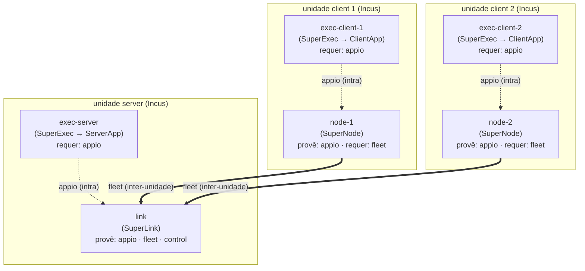

# Roadmap — implementação do modelo de componentes do orientador

Este arquivo é o **rastreador de fases** da implementação. Ele existe para que
nenhuma fase seja pulada: cada fase tem objetivo, artefato verificável e critério
de saída, e só começa quando a anterior tem o critério satisfeito.

| Campo | Valor |
| --- | --- |
| **Fase atual** | **Fases 0 (0-C) a 5 concluídas** (2026-09-25) — próxima: **Fase 6** (run federado completo) |
| **Branch** | `feat/hpcshelf-component-model` |
| **Modelo-alvo** | comunicação (`link` + `node`) e exec (`exec-server` + `exec-client`), ligados por `appio` (intra-unidade) e `fleet` (inter-unidade) |
| **Lógico × físico** | o modelo acima é **lógico**. A realização física agrupa `link`+`exec-server` e `node`+`exec-client`, e isso é **propriedade defendida**, não concessão: é o agrupamento que mantém `appio` em loopback (seção 4, Fase 3). A realização **separada** (um processo por unidade) existe em `env/hpcshelf/arms/three-level/`, medida e **não** registrada como conforme — ver a Fase 3 |
| **Trabalho em curso** | comparativo de **três braços** — `agrupado` × `3 níveis` × `3 níveis + scope:parent` (2026-10-03). Os **dois primeiros braços estão construídos e medidos** (descritores, 4 imagens e os dois validadores em `env/hpcshelf/arms/three-level/`); o terceiro depende da capacidade `scope: parent` da plataforma. Ele decide a **reabertura da Fase 3**; ver a nota ao fim daquela fase |
| **Piso do Python** | `>=3.12` (era `>=3.13`; baixado em 2026-10-03, com suíte verde idêntica em 3.12.13) |
| **Bloqueio do momento** | Fase 6 — material mTLS, Incus + HostAgent, e os 501 MB da imagem base do root, que só o orientador tem (seção 4, Fase 6) |
| **Baseline verde** | `validate_hpcshelf.sh` **28/28** · `smoke_hpcshelf_images.sh` **16/16** · `python -m libs.federation_components` **2/2 conformes** · `scripts/test.sh` **64 passed, 11 deselected** (re-verificado em 2026-10-03; ver a ressalva sobre argumentos na seção 6). Braço `3 níveis`: `validate_hpcshelf_three_level.sh` **39/39**, `smoke_hpcshelf_three_level.sh` **22/22**, guarda de build **9/9** |
| **Desenho de referência** | [`HPC_SHELF_INTEGRATION.md`](HPC_SHELF_INTEGRATION.md) |
| **Enquadramento conceitual** | ver seção 2 (modelo do orientador) |
| **Registro de cada fase** | seção 6 — comando e saída, não opinião |

## 1. Como este arquivo é usado

1. Antes de começar qualquer trabalho, ler a **Fase atual** e a seção 5.
2. Ao terminar uma fase, marcar o critério de saída aqui **e** registrar a
   evidência (comando + resultado) na seção 6.
3. Nunca avançar para a fase N+1 com a fase N aberta. Se for inevitável, isso
   vira uma decisão explícita registrada aqui, não um esquecimento.
4. Se um trabalho revelar que uma fase estava mal definida, **corrigir a fase
   aqui primeiro** e só depois executar.

## 2. O modelo-alvo (do orientador)

A federação é descrita como **dois componentes**, não como um conjunto de
contêineres:

| Componente | Unidade | Processo | Provê | Requer |
| --- | --- | --- | --- | --- |
| **comunicação** | `link` (server) | `SuperLink` | `appio`, `fleet`, `control` | — |
| | `node` ×N (client) | `SuperNode` | `appio` | `fleet` |
| **exec** | `exec-server` (server) | `SuperExec` → ServerApp | — | `appio` |
| | `exec-client` ×N (client) | `SuperExec` → ClientApp | — | `appio` |

Ligações: `exec-server → link` e `exec-client → node` são **intra-unidade**;
`node → link` (`fleet`) é a **única** que cruza unidade.



**Distinção que governa tudo:** o modelo acima é **lógico** (quem é unidade de
quem, quem provê o quê). A realização **física** na HPC Shelf hoje agrupa
`link`+`exec-server` numa unidade e `node`+`exec-client` noutra, porque R3 e R6
são mutuamente exclusivas: dependência horizontal só resolve dentro do mesmo
componente, e uma composição aninhada só admite **uma** réplica interna por
réplica de host. Ver `HPC_SHELF_INTEGRATION.md` seção 4.

Ou seja: **o modelo de 4 unidades separadas é a opção B** do documento de
integração, e continua condicionado a uma evolução da plataforma.

## 3. Inventário — o que já existe (não reimplementar)

Três artefatos já implementam partes do modelo. **Nenhum deles deve ser
reescrito antes da Fase 0.**

| # | Artefato | Onde | Unidades | Estado |
| --- | --- | --- | --- | --- |
| **A** | `env/hpcshelf/` | este repo (não commitado) | `hub` / `hospital` | Descritores validados **25/25**; imagens construídas (7,1 GiB) e testadas **8/8**; publicação ensaiada **18/18** |
| **B** | `federated-learning:1.0` + `root-fl:1.0` + `fl_unit/` | `hpcshelf-model`, `develop` @ `68f0ace` (**não commitado lá**) | `aggregator` / `client` | **853 testes passando** (+72); imagens **não existem** (digests marcadores) |
| **C** | `flower_app/` | este repo (commitado) | — | A carga. Entregue por `flwr run` como FAB |

Três fatos que a investigação estabeleceu e que condicionam o roadmap:

1. **A e B são a mesma decisão de agrupamento, tomada duas vezes.** Ambos põem o
   processo de longa duração (`SuperLink`/`SuperNode`) e o efêmero (`SuperExec`)
   na **mesma unidade**. Foi a saída encontrada para R3+R6 sem mudar a
   plataforma.
2. **B espera explicitamente a carga deste repo.** O próprio documento da
   plataforma diz que o modelo e a estratégia clínica "vêm do projeto
   `~/projetos/exp/pyhealth` (`flower_app/`), entregue no `flwr run`. O
   componente não os embute." A separação é: a plataforma provê a decomposição e
   o runtime do agente; **este repo provê o Flower App**. Isso é coerente com o
   mecanismo de FAB (o código da app viaja em runtime, não na imagem).
3. **B já resolve a lacuna #1 sem patch.** `fl_unit/plan_identity.py` deriva
   `partition-id` de `UnitPlan.replica`, lendo `HPCSHELF_UNIT_PLAN`
   (`/etc/hpcshelf/unit-plan.pb`), que o UnitAgent **já monta**. O nosso
   `0001-unit-identity-environment.patch` (exportar `UNIT_REPLICA_ID` no
   ambiente) pode ser **desnecessário** — nosso `supervise-hospital.sh:42` lê
   `UNIT_REPLICA_ID`, que só existe se o patch for aplicado.

## 4. Fases

### Fase 0 — Reconciliação (GATE) — DECIDIDA: opção 0-C, executada em 2026-09-25

> **Decisão registrada (2026-09-25):** opção **0-C** — o modelo lógico vira
> referência versionada e os dois artefatos são verificados como **conformes** a
> ele, com o agrupamento documentado como realização física. Executada na mesma
> sessão; resultado ao final desta seção.
>
> A Fase 2 foi feita antes do gate por decisão explícita (registrada na seção 6),
> por ser independente de escopo.

**Objetivo.** Decidir qual artefato é a base da implementação. Sem isso, as
fases 1–7 seriam executadas duas vezes, em duas direções.

**Artefato.** Seção de decisão neste arquivo + issue no repo (`question`).

**Critério de saída.** Uma das opções abaixo escolhida, com o motivo registrado.

| Opção | O que significa | Custo |
| --- | --- | --- |
| **0-A. Adotar B** | A decomposição da plataforma (`aggregator`/`client`) passa a ser a implementação; `env/hpcshelf/` é reconciliado ou aposentado; a carga continua sendo `flower_app/` via FAB | Trabalho na plataforma (imagens, publicação); aceita o agrupamento |
| **0-B. Manter A** | `env/hpcshelf/` continua; B é referência/validação cruzada | Divergência mantida entre os dois repos |
| **0-C. Modelo lógico + realização física** | A seção 2 vira o **modelo de referência** versionado; A e B são verificados como **conformes** a ele, com o agrupamento documentado como realização | Trabalho novo (spec + verificador), mas desbloqueia as duas |

**Recomendação registrada:** 0-C seguida de 0-A. A razão é que o modelo de 4
unidades separadas (Fase 3) depende de mudança na plataforma, enquanto o
agrupamento já é consenso nos dois artefatos. Formalizar o modelo lógico e
verificar conformidade dá valor imediato sem esperar a plataforma — e é
pré-requisito para justificar a mudança.

**Resultado (2026-09-25).** 0-C executada:

- [x] Modelo versionado em `libs/federation_components/model.py`
      (`COMPONENT_MODEL_VERSION = "1.0.0"`): 2 componentes, 4 unidades, 3
      interfaces (`appio`, `fleet`, `control`), 3 ligações.
- [x] Verificador em `libs/federation_components/conformance.py`, com o invariante
      `appio` que nunca cruza fronteira (`M103`) e a fronteira de dados (`M105`).
- [x] **Os dois artefatos conformam**: `env/hpcshelf` (`hub`/`hospital`) e o
      catálogo da plataforma (`aggregator`/`client`) reduzem ao **mesmo** modelo.
- [x] Agrupamento documentado como realização física em `docs/ARCHITECTURE.md`
      §2.1, com diagrama Mermaid e a distinção lógico × físico.
- [x] 16 testes, com **um controle negativo por código de falha**.

```text
python -m libs.federation_components
  ✓ model agrees with itself (provides/requires vs bindings)
  ✓ env/hpcshelf (project descriptors) conforms
  ✓ catalog_data/components/federated-learning (platform catalogue) conforms
  Result: 2 realizations, all conforming

./scripts/test.sh   →  56 passed, 11 deselected   (40 antes, +16)
```

**Efeito.** "Qual dos dois artefatos é a base?" deixa de ser pergunta excludente:
ambos **são** o mesmo modelo, provado. O que resta de 0-A é escolher qual deles
materializa o modelo — decisão de conveniência, não de correção. E a opção B
(quatro unidades separadas) ganha um argumento formal: hoje ela falha em `M103`, e
é exatamente isso que a mudança de plataforma precisa resolver.

**Bloqueio.** Nenhum. Gate fechado.

---

### Fase 1 — Congelar o modelo lógico — CONCLUÍDA em 2026-09-25

Satisfeita pelos mesmos artefatos da 0-C: a 0-C **é** o congelamento do modelo.

**Critério de saída.**
- [x] Modelo escrito com unidades, processos, interfaces e ligações —
      `libs/federation_components/model.py`.
- [x] Diagrama Mermaid atualizado em `docs/ARCHITECTURE.md` §2.1.
- [x] Distinção lógico × físico registrada, com as duas grafias de realização
      nomeadas (`hub`/`hospital` e `aggregator`/`client`).
- [x] **Extra, não previsto:** o modelo ficou *verificável*, não só escrito —
      `python -m libs.federation_components`.

**Bloqueio.** Nenhum. Fase fechada.

---

### Fase 2 — Identidade por réplica (lacuna #1) — CONCLUÍDA em 2026-09-25

**Objetivo.** Cada unidade descobrir *qual* réplica ela é, sem literal no
`application.environment` do descritor e sem adivinhar.

**Artefato.** `env/hpcshelf/arms/grouped/images/supervise-hospital.sh` lendo `plan.replica`.

**Critério de saída.**
- [x] Verificado que `HPCSHELF_UNIT_PLAN` → `/etc/hpcshelf/unit-plan.pb` está
      legível dentro das nossas imagens: `/opt/hpcshelf/venv` traz
      `common_pb2.UnitPlan` com protobuf 7.36.1.
- [x] Supervisor passa a ler o plano; `PYHEALTH_PARTITION_ID` fica como override
      explícito. **O plano vence o override**, porque um binding de descritor é
      compartilhado por todas as réplicas e nunca pode decidir identidade.
- [x] Patch `0001-unit-identity-environment.patch` **retirado do pedido**
      (`patches/README.md`, `HPC_SHELF_ORIENTADOR_REQUEST.md`, `images/README.md`,
      `HPC_SHELF_INTEGRATION.md`) e mantido só como proveniência e reserva.
- [x] Hospital sem identidade continua **recusando iniciar** — o controle
      negativo segue passando.

**Resultado.** `scripts/smoke_hpcshelf_images.sh` → **10 passed, 0 failed**
(antes 8/8). Os dois checks novos:

```text
✓ a hospital derived its partition from its own unit plan
✓ the plan beat the conflicting PYHEALTH_PARTITION_ID override
```

**Efeito no pedido ao orientador:** o único item funcional que exigia mudança na
plataforma desapareceu. Restam só as três confirmações de publicação.

**Ressalva registrada.** `num-partitions` é uma cardinalidade, igual em todas as
réplicas, então um binding compartilhado é correto para ele — mas deve coincidir
com o número de hospitais, e **a divergência não é detectada aqui**. A
plataforma resolve isso com um teste que falha quando o valor diverge do plano
(`tests/test_fl_catalog_plan.py`). Vale copiar essa guarda antes da Fase 6.

**Bloqueio.** Nenhum. Fase fechada.

---

### Fase 3 — Descritores do modelo-alvo — CONCLUÍDA em 2026-09-25

**Objetivo.** Expressar o modelo da Fase 1 em descritores HPC Shelf e provar o
que a plataforma aceita e recusa.

**Artefato.** `env/hpcshelf/arms/grouped/model_split.py` + controles novos em
`env/hpcshelf/arms/grouped/validate.py`.

**Critério de saída.**
- [x] Descritores declaram as interfaces: `link` provê `appio`/`fleet`/`control`;
      `node` provê `appio` e requer `fleet`; `exec-*` requer `appio`.
- [x] **Controle negativo da decomposição do modelo** no validador, para
      `node`/`exec-client`: as duas variantes falham com os códigos previstos.
- [x] Saída registrada na seção 6.

**Resultado.** `scripts/validate_hpcshelf.sh` → **28 passed, 0 failed** (25 antes).

| Variante | Co-localização | Dependência | Resultado |
| --- | :---: | :---: | --- |
| 4 unidades num componente | recusada (R6) | resolve | `C017` ×3 |
| 2 componentes, composições separadas | permitida | recusada (R3) | `C002` ×2 |
| `comunicacao` {link, node} sozinho | — | resolve | **válido** |

**Duas conclusões que a execução produziu e o argumento não produzia:**

1. **O bloqueio é especificamente `appio`.** `fleet` sobrevive à fronteira de
   componente quando as duas pontas estão dentro dele — `comunicacao` valida
   sozinho. Só `appio` não passa. Logo a mudança mínima na plataforma é
   exatamente a da seção 4.5 do documento de integração: deixar `dependencies`
   alcançar unidade de componente irmão.
2. **A separação obriga o AppIO a sair do loopback.** Hoje `appio` é
   127.0.0.1 dentro de um contêiner; separando, passa a cruzar fronteira de
   *contêiner*. Isso não infringe `env/incus/PORTS.md`, que enuncia a regra no
   nível da **unidade Incus** (a instituição), não do contêiner — desde que as
   duas unidades fiquem co-localizadas no mesmo host, que é o que a variante 2 faz.

**Decisão — RESOLVIDA em 2026-09-25: a variante 2 não será viabilizada.**

O modelo da Fase 1 enuncia o invariante no nível do **contêiner**. `PORTS.md`
enuncia no nível da **instituição**. Os dois coincidem hoje porque o agrupamento
mantém `appio` em loopback, mas divergem na variante 2:

| Leitura | Hoje (agrupado) | Variante 2 (separado, co-localizado) |
| --- | :---: | :---: |
| nível instituição (`PORTS.md`) | satisfeito | satisfeito |
| nível contêiner (modelo 0-C) | satisfeito | **violado** (`M103`) |

Se o invariante que importa é o da instituição, a variante 2 é segura e o único
obstáculo é `C002`. Se é o do contêiner, a separação é indesejável **mesmo** que a
plataforma a permita — e o agrupamento deixa de ser concessão e passa a ser
propriedade.

**Decisão:** ficamos com o agrupamento. O invariante que vale é o **nível
contêiner** — `appio` não cruza fronteira de unidade física. Consequências:

- O agrupamento deixa de ser concessão a R3+R6 e passa a ser **propriedade
defendida**: é ele que mantém `appio` em loopback.
- `M103` deixa de significar "um defeito que você pode ter" e passa a significar
  "a invariante deliberada". O verificador não muda; a leitura dele muda.
- A separação em quatro unidades fica **documentada e não perseguida**, para que
  a decisão seja reversível com o raciocínio intacto.
- O pedido de mudança na plataforma **encolhe**: nada de viabilizar a variante 2.
  A §4.5 do documento de integração permanece como registro, marcada como não
  solicitada.

**Bloqueio.** Nenhum, à época. Fase fechada — e **reaberta em 2026-10-03**, abaixo.

> **Reaberta em 2026-10-03.** O raciocínio acima trata o trade como binário: ou o
> `appio` cruza fronteira de contêiner (violando `M103`), ou se agrupa. Dois
> fatos apurados depois mostram que há terceira via, e que o obstáculo não é de
> capacidade:
>
> 1. **O endereçamento vertical existe.** `_collect_forwarded_services` mantém a
>    `published_port` constante por todos os níveis, e o pai alcança o serviço do
>    filho no próprio namespace. Nenhum patch de dependência é necessário: o pai
>    deriva o endereço lendo o próprio plano (`UnitPlan.children`).
> 2. **Mas a plataforma publica todos os descendentes no endereço VPN.**
>    `hostagent/endpoint_publisher.py` é recursivo e não filtra:
>    `VPN:published -> Incus:...` para cada serviço de cada descendente. Então na
>    variante 2 o `appio` fica alcançável por qualquer host da federação. É
>    **isso**, e não a fronteira de contêiner em si, que o invariante protege.
>
> **O que muda:** `M103` é um **proxy** do invariante, não o invariante. O que se
> quer é "`appio` não alcançável além do seu pai imediato". Enquanto a plataforma
> não souber declarar um serviço interno, o proxy é exato — e é por isso que o
> agrupamento funcionava. Com serviço declarado interno (`scope: parent`, campo
> **ausente** em `ServiceDefinition`), o proxy deixa de ser necessário.
>
> **Leitura corrigida da decisão:** não é "a separação é indesejável"; é "a
> separação exige uma capacidade da plataforma que ainda não existe". Se o
> invariante que vale é a exposição (e não a fronteira física), a variante 2 é
> aceitável assim que `scope: parent` existir. O comparativo de três braços mede
> exatamente isso, e é ele que fecha ou reafirma esta fase.
>
> O raciocínio original fica preservado: se o professor recusar o conceito de
> serviço interno, a decisão de 2026-09-25 volta a valer como estava.

**Braços 1 e 2 construídos e medidos (2026-10-05).** `env/hpcshelf/arms/three-level/` é
o braço `3 níveis` como artefato executável: 3 descritores (`comunicacao`,
`exec`, `three-level-root`), a aplicação, 4 imagens de unidade e dois provadores.
O plano materializa 9 unidades em 3 níveis — `institution[i]` (Incus) →
`exec-*` (Podman) → `link`/`node` (Podman) — e a medição é feita pelo **mesmo**
`EndpointPublisher` nos dois braços, no mesmo processo:

| Braço | Unidades | `appio` publicado | Endereço | Imagem de transporte |
| --- | :---: | :---: | --- | --- |
| `agrupado` (`env/hpcshelf/`) | 6 | **0** | loopback dentro do contêiner | n/a (mesma imagem) |
| `3 níveis` (`arms/three-level/`) | 9 | **3** | `10.201.0.{1,2,3}:30000` | sem corpus, sem stack de ML (~1,1 GB vs ~7,3 GB) |

Três conclusões que a execução produziu:

1. **A ligação vertical não é declarável, e isso agora é um controle negativo.**
   Declarar `exec-server -> link.appio` como `dependencies` falha com **C002**
   (`arms/three-level/validate.py` afirma esse código). O endereço só existe porque o
   pai lê o próprio plano (`UnitPlan.children[].services[]`) e disca
   `127.0.0.1:<published_port>` — mecanismo exercitado pelo smoke, com controle
   negativo para o caso de não haver filho (falha em vez de ficar ocioso).
2. **O que a separação compra é verificável no artefato, não só no argumento.**
   `flower-link`/`flower-node` não contêm `data/`, `flower_app`, torch nem
   pyhealth: as unidades de transporte não conseguem ler um registro. No braço
   agrupado isso é impossível por construção.
3. **Uma federação inteira em um só host não é expressável neste braço.** A
   composição aninhada comporta uma réplica interna por réplica de host, então
   `exec-server` e `exec-client` no mesmo `institution` é recusado com **C017**
   (afirmado em `validate.py`). Co-localizar por composições separadas é
   permitido, mas rompe `node → link`, porque dependência só resolve dentro de um
   `component_path`. Um host = um papel = uma fronteira de dados.

Provas do braço: build + guarda de papéis **9/9**,
`scripts/validate_hpcshelf_three_level.sh` **39/39**,
`scripts/smoke_hpcshelf_three_level.sh` **22/22**. O braço **não** é registrado como
`Realization` em `libs/federation_components`: ele gasta `M103` por construção, e
um verificador com exceção para o caso que ele existe para pegar seria mais fraco.

---

### Fase 4 — Imagens das unidades — CONCLUÍDA em 2026-09-25

**Objetivo.** Manter as imagens agrupadas e transformar em verificação as
invariantes que até aqui eram prosa.

**Decisão de escopo.** O ramo "uma imagem por unidade, um processo por contêiner,
sem supervisores" fica **fora**, pela decisão da Fase 3: separar forçaria `appio`
a sair do loopback. As imagens continuam sendo `flower-hub` e `flower-hospital`,
com os supervisores.

**Critério de saída.**
- [x] Build verificado (`scripts/build_hpcshelf_images.sh`; a imagem do hospital
      foi reconstruída na Fase 2, já com o supervisor que lê o plano).
- [x] Restrições conhecidas preservadas **e assertadas**: dois interpretadores
      (protobuf 7.x do UnitAgent vs 6.x do Flower), venv do UnitAgent recriado e
      não copiado, `HPCSHELF_PODMAN_RUNTIME=mock` com ausência do binário podman.
- [x] `scripts/smoke_hpcshelf_images.sh` → **16 passed, 0 failed** (10 antes).

Os seis checks novos substituem o que era prosa na seção 5 do documento de
integração. Uma imagem-base que quebre um deles agora é um ✗, e não uma surpresa
durante um deployment.

**Bloqueio.** Nenhum. Fase fechada.

---

### Fase 5 — Prova — CONCLUÍDA em 2026-09-25

**Critério de saída.**
- [x] `scripts/validate_hpcshelf.sh` verde, com os controles negativos → **28/28**.
- [x] `scripts/smoke_hpcshelf_images.sh` verde → **16/16**.
- [x] Propriedade forte reproduzida → `tests/test_fedavg_identity.py`, **8 passed**.
- [x] **Nenhum round federado completo ainda** — a ressalva continua de pé: a prova
      aqui é de fiação, registro e álgebra da agregação, não de um run federado
      de ponta a ponta. Não declarar mais do que isso.

**A propriedade.** Com um passo local por rodada e ponderação por `num-examples`,
uma rodada de FedAvg *é* um passo de SGD centralizado — identidade, não
aproximação:

```text
theta_f = sum_i (n_i/N) (theta_0 - eta grad L(B_i))
        = theta_0 - eta grad L(B) = theta_c
```

Medido: o gap entre federado e centralizado fica em **~3e-8** (ruído de float32)
contra uma tolerância de `1e-5`, e o passo move os parâmetros em ~0.16 — não passa
por vacuidade.

**Desenho.** Usa código de produção, não reimplementação: o particionamento vem de
`flower_app.task.shard`, a chave de ponderação vem de
`flower_app.strategies.build_strategy` (o teste **consome** a configuração, então
mudar o `weighted_by_key` quebra o teste), e a agregação é
`aggregate_arrayrecords` do Flower — a mesma função que `FedAvg.aggregate_train`
chama.

**Controles negativos — um por coisa que um run federado pode errar:**

| Controle | O que prova | Gap medido |
| --- | --- | --- |
| chave de ponderação constante, partições desiguais | ponderação errada quebra | `2.0e-2` |
| uma partição treinada duas vezes | nó treinando em dado que não é dele quebra | > `1e-5` |
| dois passos locais por rodada | a identidade é por passo; não sobrevive à composição | > `1e-5` |
| learning rate zero | a guarda de movimento não é decorativa | recusa |

O último é um meta-controle: com `lr=0` os dois lados são iguais a `theta_0` e a
identidade vale **por vacuidade**. `MIN_MOVEMENT` existe para recusar isso, e o
teste prova que ele recusa.

**Bloqueio.** Nenhum. Fase fechada.

---

### Fase 6 — Run federado completo

**Objetivo.** Observar um round federado agregar de verdade, na plataforma.

**Critério de saída.**
- [ ] `flwr run` contra o Control API do hub, exposto na rede de administração.
- [ ] Log do ServerApp mostrando `aggregate_train: Received N results and 0
      failures` — e **N igual ao número de hospitais**. Um round com
      `failures > 0` não conta como aprovado: o `FedAvg` do ServerApp não tem
      `accept_failures` e agrega o que chegou, silenciosamente.
- [ ] `RunManifest` de `libs/federation_contracts` emitido (exigido pela
      política de commits para qualquer resultado reportado).

**Bloqueio — reanalisado em 2026-09-25.** O bloqueio **não é o catálogo**. Verificado
localmente, com o servidor de catálogo da própria plataforma:

| Passo | Precisa de | Resultado |
| --- | --- | --- |
| catálogo local (`catalog_server.py --catalog-root`) | a árvore de ensaio | ✅ serve `/api/v1/components/{ref}/versions/{v}` com ETag |
| `validate` | só o catálogo | ✅ `{"errors": [], "valid": true}` |
| `plan` | catálogo + aplicação + inventário | ✅ 6 unidades, `SUPERLINK_HOST`/`PORT` injetados |
| `preflight` | + material mTLS | ❌ `input_invalid` / `local_input` |

`validate` e `plan` rodam **100% locais**: sem Incus, sem artefato do
orientador, sem autorização. O `preflight` falha em **validação de entrada
local**, antes de tocar a rede — então a fiação mTLS é verificável assim que
houver material, sem depender da rede dele.

O que falta, exatamente:

1. **Material mTLS** (CA + chave e certificado de cliente), gerado no
   provisionamento do host;
2. **Incus + HostAgent** — `incus` está ausente nesta máquina; há `/dev/kvm` e
   `snap`, então é instalável;
3. **Os bytes da imagem base do root** — 501 MB, publicados apenas em
   `catalog.hpcshelf.org`, que **responde timeout** daqui. É o único insumo que
   só o orientador tem.

Os três são trabalho local ou um pedido de **um arquivo**. Nenhum é autorização
de escrita no catálogo dele — que só faz falta para tornar o resultado
*autoritativo* no catálogo dele, não para validar o trabalho.

**Fricção registrada.** O `plan` da CLI precisa de `--vpn-base-network
10.201.0.0/16 --vpn-prefix-length 24` para casar com o `hosts.yaml`, porque o
default do planner (`10.200.0.0/24`) não contém os endereços pré-alocados. O
`validate.py` já sabe disso; um usuário da CLI não. Cabe nota em
`env/hpcshelf/README.md`.

---

### Fase 7 — Governança

Itens já registrados como lacunas #3, #4 e #6 na integração.

**Critério de saída.**
- [ ] TLS: alinhar mTLS/VPN da plataforma com o TLS do Flower e remover
      `--insecure`.
- [ ] Dados: MIMIC demo embutido é aceitável; **SESA-CE nunca entra em imagem**,
      só injeção na unidade do hospital.
- [ ] DP: o orçamento (ε) declarado no manifesto quando `dp-mode != none`.
- [ ] DP central e ausência de agregação segura continuam limitações declaradas.

**Bloqueio.** Fase 6.

## 5. Regras para não pular fases

1. **Uma fase por vez.** O gate da seção 4 manda.
2. **Toda fase deixa evidência executável** na seção 6: comando e saída, não
   opinião. O repo já tem o hábito de controle negativo; manter.
3. **Nunca declarar mais do que a prova estabelece.** Assinatura registrada em
   dois lugares: "a prova não estabelece que isso implanta" e "nenhum round
   federado completo ainda". Essas ressalvas só caem quando a Fase 6 fechar.
4. **Controle negativo junto do positivo.** Um validador verde é
   indistinguível de um validador que não verifica nada.
5. **Nada de dado de paciente** em imagem, log ou commit. Ver
   `docs/DATA_GOVERNANCE.md`.
6. **Se uma fase revelar que o desenho está errado, corrigir o desenho aqui
   antes de continuar** — foi o que aconteceu com o requisito 1 da seção 5 do
   documento de integração, que estava errado e foi substituído.

## 6. Registro de progresso

| Data | Fase | Evidência | Resultado |
| --- | --- | --- | --- |
| 2026-10-05 | 3 | `env/hpcshelf/arms/three-level/`: 3 descritores + aplicação + `validate.py` (`HPCSHELF_MODEL_ROOT=~/projetos/exp/hpc-shelf/hpcshelf-model scripts/validate_hpcshelf_three_level.sh`) | **39/39** — 9 unidades em 3 níveis; `fleet` injetado; `appio` publicado em `10.201.0.{1,2,3}:30000`; **C002** no controle negativo da ligação vertical declarada; **D012**/**C017** ainda policiam o `overlap` |
| 2026-10-05 | 4 | `Containerfile.flower-comm` + `supervise-{comm,link,node}.sh`; build com guarda de papéis das 4 imagens | **9/9** — transporte sem corpus/torch/pyhealth/`data/`, 4 camadas distintas, 1 papel por imagem; `flower-link`/`flower-node` em **1,1 GB** contra **7,3 GB** do `exec` |
| 2026-10-05 | 5 | `scripts/smoke_hpcshelf_three_level.sh` | **22/22** — `appio` em `0.0.0.0` (não loopback) nos dois papéis; 2 nodes registram no `link` com partição própria; node recusa sem `SUPERLINK_HOST` e sem identidade; pai lê a porta do filho do próprio plano e falha rápido sem filho |
| 2026-10-03 | — | piso do Python: `requires-python` `>=3.13` → `>=3.12`, `.python-version`, ruff `py312` | pré-requisito do braço "3 níveis" (o nível do meio aninha Podman e vem de `podman-unit-base`, que é 3.12) |
| 2026-10-03 | — | suíte em 3.12.13 (`/var/tmp/pyhealth312`, e depois o `.venv` canônico) | **64 passed, 11 deselected** e **75 passed** — idêntico ao 3.13 |
| 2026-10-03 | — | `uv lock` + `git diff uv.lock` | re-lock necessário (o piso muda os marcadores). **Nenhuma versão de pacote mudou** — torch 2.7.1, numpy 2.2.6, pyhealth 2.0.1, flwr 1.34.0 intactos |
| 2026-10-03 | — | `HPCSHELF_MODEL_ROOT=~/projetos/exp/hpc-shelf/hpcshelf-model scripts/validate_hpcshelf.sh` | **28/28** contra o clone canônico (que tem `federated-learning` e `fl_unit/` não commitados) |
| 2026-10-03 | — | `scripts/smoke_hpcshelf_images.sh` | **16/16** |
| 2026-10-03 | 3 | `EndpointPublisher.build_publications` + `client_server_verifier._target` | reabertura registrada acima |
| 2026-10-03 | — | re-verificação do baseline, sem mudança de código: `scripts/validate_hpcshelf.sh`, `scripts/smoke_hpcshelf_images.sh`, `python -m libs.federation_components`, `scripts/test.sh` | **28/28**, **16/16**, **2/2 conformes**, **64 passed** — baseline confirmado |
| 2026-10-03 | — | defeito encontrado em `scripts/test.sh`: `${1}` não é removido, então o pytest recebe a seleção como caminho | `test.sh fast`, `test.sh slow` e `test.sh all` → **`no tests ran`**. Só a invocação **sem argumento** funciona (é a que produz o 64 acima) |
| 2026-09-25 | 6 | `catalog_server.py` local + `hpcshelf_client.py validate/plan` contra `--catalog-url http://127.0.0.1:18080` | **validate ✅ e plan ✅ offline**; `preflight` ❌ em `input_invalid` (falta mTLS) |
| 2026-09-25 | 5 | `tests/test_fedavg_identity.py` | **8 passed** — identidade FedAvg ≡ SGD centralizado, gap `3e-8`; 4 controles negativos + meta-controle |
| 2026-09-25 | 4 | `scripts/smoke_hpcshelf_images.sh` com os 6 checks de invariante de imagem | **16 passed, 0 failed** (10 antes) |
| 2026-09-25 | 3 | decisão: variante 2 não perseguida; invariante fixado no nível contêiner | agrupamento passa a propriedade defendida |
| 2026-09-25 | 3 | descritores da decomposição do modelo em `env/hpcshelf/arms/grouped/model_split.py` no validador | 4 unidades num componente → `C017` ×3; 2 componentes → `C002` ×2; `comunicacao` sozinho → **válido** |
| 2026-09-25 | 3 | `scripts/validate_hpcshelf.sh` | **28 passed, 0 failed** (25 antes) |
| 2026-09-25 | 0-C | `python -m libs.federation_components` | modelo auto-consistente; **2 realizations, all conforming** |
| 2026-09-25 | 0-C | `.venv/bin/python -m pytest tests/test_federation_components.py` | **16 passed**, um controle negativo por código (`M001`–`M003`, `M101`–`M106`) |
| 2026-09-25 | 0-C | `./scripts/test.sh` | **56 passed, 11 deselected** (40 antes, +16) |
| 2026-09-25 | 1 | `docs/ARCHITECTURE.md` §2.1 + diagrama Mermaid | distinção lógico × físico registrada |
| 2026-09-25 | 2 | `grep HPCSHELF_UNIT_PLAN` no UnitAgent (`real_podman_runtime.py:1109`, `server.py:147`, `incus_bootstrap.py:26`) | a plataforma já injeta o plano para toda unidade, raiz **e** aninhada |
| 2026-09-25 | 2 | `podman run … /opt/hpcshelf/venv/bin/python -c 'import common_pb2'` na nossa imagem | `common_pb2.UnitPlan` (`hpcshelf.control.v1.UnitPlan`) legível, protobuf 7.36.1 |
| 2026-09-25 | 2 | plano sintético (`replica=1`) lido de volta via `HPCSHELF_UNIT_PLAN` | `partition-id=1` derivado sem patch |
| 2026-09-25 | 2 | `scripts/smoke_hpcshelf_images.sh` (imagem do hospital reconstruída) | **10 passed, 0 failed** (antes 8/8) |
| 2026-09-25 | 2 | plano (`replica=1`) + `PYHEALTH_PARTITION_ID=0` conflitante | venceu o plano: `node-config='partition-id=1'` |
| 2026-09-25 | 0 | `HPCSHELF_MODEL_ROOT=~/projetos/exp/hpc-shelf/hpcshelf-model scripts/validate_hpcshelf.sh` | 25 passed, 0 failed (baseline reconfirmado) |
| 2026-09-25 | 0 | `git status` em `hpcshelf-model` (`develop` @ `68f0ace`) | **sujo**: `fl_unit/`, `catalog_data/components/federated-learning/`, `root-fl/`, `docs/FEDERATED_LEARNING_COMPONENT.md` não commitados |
| 2026-09-25 | 0 | `grep UNIT_REPLICA_ID env/hpcshelf/arms/grouped/images/supervise-hospital.sh` | linha 42 depende do patch não aplicado; `fl_unit/plan_identity.py` da plataforma não precisa dele |

## Referências

- [`HPC_SHELF_INTEGRATION.md`](HPC_SHELF_INTEGRATION.md) — desenho congelado,
  restrições R1–R9, decisão da lacuna #2, fases 0–2 e o que ficou aberto.
- [`HPC_SHELF_ORIENTADOR_REQUEST.md`](HPC_SHELF_ORIENTADOR_REQUEST.md) — o que
  falta para publicar e o patch em revisão.
- [`ARCHITECTURE.md`](ARCHITECTURE.md) — topologia da camada de federação e o
  round federado.
- [`DEPLOYMENT.md`](DEPLOYMENT.md) — runtime de deployment em contêineres
  (topologia de máquina única) e o invariante de porta AppIO.
- `env/hpcshelf/README.md` — artefatos e como rodar as provas.
- `env/incus/PORTS.md` — inventário de serviços e portas.
