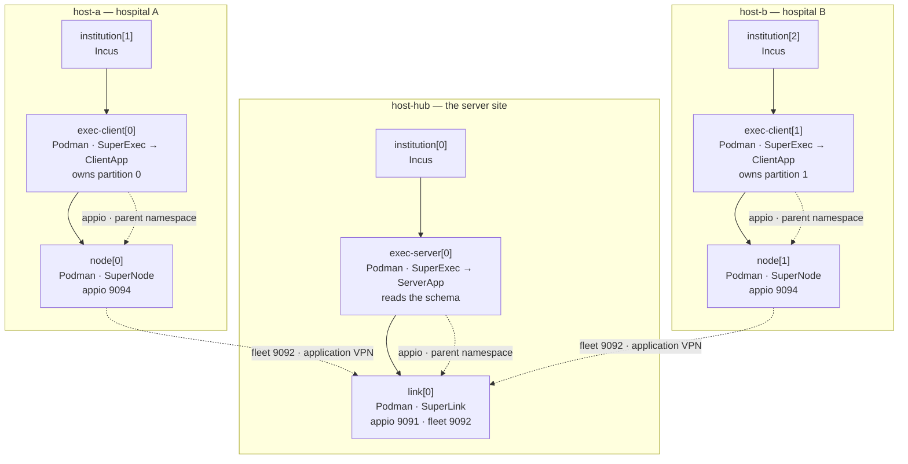

# `env/hpcshelf/arms/three-level/` — the three-level arm

The same federation as `../grouped`, deployed with **one physical unit per logical unit**
instead of two. Four units — `exec-server`, `exec-client`, `link`, `node` — each in
its own container, instead of the grouped `hub` / `hospital` pair.

This directory exists because the grouped arm's own reasoning is falsifiable, and
`docs/HPC_SHELF_ROADMAP.md` (Phase 3, reopened 2026-10-03) says so: what the
invariant protects is not "`appio` must not cross a container boundary", it is
"`appio` must not be reachable beyond its immediate parent". In the grouped arm
the second follows from the first; here it does not, and this arm is what measures
the difference.

```text
arm               units  appio published  per-host  data in transport image
agrupado (../grouped)        6  0 (loopback)     fleet     n/a (one image)
3 níveis (here)       9  3 (VPN)          fleet     no
```

## Topology



Solid edges are containment (`nestedComponents` + `overlap`). Dotted edges are
calls: the vertical ones stay on the host, the horizontal one crosses it.

**One host, one role.** The two `exec` units never share a host replica: a nested
composition admits one inner replica per host replica, so putting `exec-server`
and `exec-client` on the same `institution` is refused with **C017** (asserted in
`validate.py`). Co-locating them through *separate* compositions is allowed, but it
severs `node → link`, because a dependency resolves only inside one
`component_path`. A single-host federation is therefore not expressible in this
arm: one host is one role, and one host is one data boundary. That is a property of
the platform's model, not of the descriptors here; the grouped arm has the same
constraint for a different reason (its two units would collide in C017 as well).

## The four units

| Unit | Component | Image | Runs | Services | Boundary |
| --- | --- | --- | --- | --- | --- |
| `exec-server` | `exec` | `flower-exec-server` | SuperExec → ServerApp | — | — |
| `exec-client` | `exec` | `flower-exec-client` | SuperExec → ClientApp | — | **data**: the only unit that reads records |
| `link` | `comunicacao` | `flower-link` | SuperLink | `appio` 9091, `fleet` 9092 | — |
| `node` | `comunicacao` | `flower-node` | SuperNode | `appio` 9094 | — |

Two consequences that the grouped arm cannot offer, and that the artefacts make
checkable rather than arguable:

* **the transport units hold no data.** `flower-link`/`flower-node` are built
  without `flower_app`, `libs` or `data/`, carry no torch and no PyHealth, and are
  ~1.1 GB against ~7.3 GB. A unit whose whole job is to move parameters cannot read
  a record. `scripts/smoke_hpcshelf_three_level.sh` asserts all of it on the image.
* **one process per unit, so no supervisor script.** In the grouped arm `hub` and
  `hospital` each need a process supervisor because two Flower processes share the
  container. Here each supervisor `exec`s one process, and the unit's exit status
  *is* the Flower process's exit status.

## How the two bindings are realised

There are three bindings in the logical model and two mechanisms, and the
difference between them is the arm's central finding.

**Horizontal — `node → link.fleet` — declarable.** Both units belong to
`comunicacao`, so a `dependencies` entry resolves (R3) and the platform injects
`FL_SUPERLINK_HOST` (the application-VPN address of the server host) and
`FL_SUPERLINK_PORT` (the published port of `fleet`) into every `node`. This is what
carries a SuperNode across the institution boundary.

**Vertical — `exec-server → link.appio`, `exec-client → node.appio` — not
declarable.** The call is from the parent to the unit it hosts. `dependencies`
resolves inside one `component_path` and `semantic_validator` refuses a target in
another component (C002), which `validate.py` proves by declaring exactly that
dependency and watching it fail.

The platform still supports the call, through two documented properties:

1. `unitagent/real_podman_runtime._collect_forwarded_services` keeps the
   `published_port` constant at every nesting level, so the parent's namespace
   binds `127.0.0.1:<published_port>` straight to the child's `container_port`;
2. the parent's own `UnitPlan` carries its whole subtree, so
   `UnitPlan.children[].services[]` is where the parent learns
   `<published_port>`.

`images/supervise-exec.sh` does exactly that read. That is why the exec image is
~10 lines longer than it would be otherwise, and why `validate.py` asserts the C002
refusal: the mechanism must stay a necessity, not a preference.

## The cost, measured

For the parent to learn that port, `appio` has to be **declared** as a service —
and `hostagent/endpoint_publisher.build_publications` is recursive and does not
filter: every declared service of every descendant is published at
`<host VPN address>:<published_port>`. So in this arm `appio` is reachable by every
host of the federation, not only by its parent:

```text
link[0] appio:9091 -> 10.201.0.1:30000
node[0] appio:9094 -> 10.201.0.2:30000
node[1] appio:9094 -> 10.201.0.3:30000
```

`validate.py` prints that table and asserts it, and runs the same function over
`../grouped/components/` in the same process: the grouped arm publishes `fleet` and
nothing else, because its `appio` is loopback inside a container that is not
declared as a service at all.

What would make the split free is a **parent-scoped publication** — `scope: parent`
on a `ServiceDefinition` — which does not exist today. Until it does, the choice is
the one Phase 3 records: pay the exposure, or group.

`control` (9093) is deliberately left **undeclared** in both arms, so it is neither
mapped nor published; making it reachable is the management-network decision of
Phase 6, and both arms are equally blocked on it.

## Layout

```text
env/hpcshelf/arms/three-level/
├── components/
│   ├── comunicacao/0.1/component.yaml        # leaf: link + node (transport)
│   ├── exec/0.1/component.yaml               # middle: exec-* + nests comunicacao
│   └── three-level-root/0.1/component.yaml   # root: one Incus unit per host
├── applications/pyhealth-federation-three-level.yaml
├── images/
│   ├── Containerfile.flower-exec             # middle level (nests Podman)
│   ├── supervise-exec.sh                     # reads its child's appio from its plan
│   ├── supervise-exec-{server,client}.sh     # role wrappers
│   ├── Containerfile.flower-comm             # leaf level (transport only)
│   ├── supervise-comm.sh                     # SuperLink / SuperNode
│   └── supervise-link.sh, supervise-node.sh  # role wrappers
├── validate.py                               # platform validator + planner + measurement
└── README.md
```

The host inventory is **not** duplicated here: the application uses
`../../hosts.yaml`, the same synthetic inventory the grouped arm uses, so the two arms
differ in topology and nothing else.

## Running the three proofs

```bash
scripts/build_hpcshelf_three_level.sh                            # 4 images + role guard
HPCSHELF_MODEL_ROOT=~/projetos/exp/hpc-shelf/hpcshelf-model \
    scripts/validate_hpcshelf_three_level.sh                      # 39 checks
scripts/smoke_hpcshelf_three_level.sh                             # 22 checks
```

| Proof | What it establishes | Result |
| --- | --- | --- |
| build + role guard | four distinct images, each carrying exactly one role | 9/9 |
| `validate.py` | the platform accepts the three descriptors; the plan has 3 levels, 9 units; `fleet` is injected; **`appio` is on the VPN**; C002 rejects the declarable version of the vertical binding; D012/C017 still police the mapping; a single-host federation is refused | 39/39 |
| `smoke_hpcshelf_three_level.sh` | the transport image has no corpus and no ML stack; `appio` binds `0.0.0.0` on both units; two nodes reach a `link` and register with their own partition ids; a node fails without the injected SuperLink and without a partition identity; the exec supervisor reads its child's port from its own plan and fails fast when there is none | 22/22 |

The same three commands against the grouped arm are
`scripts/build_hpcshelf_images.sh`, `scripts/validate_hpcshelf.sh` and
`scripts/smoke_hpcshelf_images.sh`.

## Identity and non-IID drift

`partition-id = plan.replica`, as in the grouped arm, but it now travels one hop
further: the SuperNode publishes it through `--node-config`, and the ClientApp in
the parent unit reads it from `context.node_config`. That is only sound because
`overlap` maps `node[i]` onto `exec-client[i]`, so the partition the node
advertises is the partition its parent owns. `validate.py` asserts
`node[i].replica == exec-client[i].replica` for every replica, and that
`num-partitions` agrees in all three places that declare it (the `comunicacao`
descriptor, the `exec` descriptor and the app's run config) — a mismatch there
would change the DP sampling budget and the reported client count without failing
anything.

Non-IID handling is untouched by this arm: partitioning, `label-skew` and the
aggregation strategy all live in `flower_app/`, and the split moves *where* the
ClientApp runs, not what it does. FedProx (Li et al. 2018) remains the response to
heterogeneity; FedAvg (McMahan et al. 2017) remains the baseline.

## Privacy and security posture

| Property | State in this arm |
| --- | --- |
| SESA-CE records | never in an image, never in a commit. The images carry only the MIMIC-IV demo, and only in the `exec` units |
| DP | architectural requirement, unchanged by the topology: the ClientApp applies it where the data is, so the split does not alter the noise. `PYHEALTH_DP_MODE=none` by default and the budget is not reported yet (Phase 7) |
| `appio` exposure | **spent**: published on the application VPN (see above). This is the arm's cost, and the reason the arm is not the default |
| `fleet` | crosses the boundary, in the application VPN, as in the grouped arm |
| TLS | absent (`--insecure`) in both arms; Phase 5/7 |
| Secure aggregation | absent in both arms |
| Units run as root | inherited from the platform base, in both arms; hardening item |

## Why this arm is not registered as a `Realization` in `libs/federation_components`

`model.py` lists the conforming realizations, and `python -m libs.federation_components`
checks them. This arm violates `M103` by construction — `appio` crosses a unit
boundary — so registering it would either fail the checker or force an opt-out into
it. A checker with an exemption for the case it exists to catch is a weaker
checker. The arm stays measured (here and in `validate.py`) rather than registered,
and that choice is reversible if the model later distinguishes "crosses a unit
boundary" from "reachable beyond its parent".

## Open items

| Item | Whose | Detail |
| --- | --- | --- |
| `scope: parent` for a service | platform | the capability that would make this arm free. Absent from `ServiceDefinition`; `docs/HPC_SHELF_ORIENTADOR_REQUEST.md` is where the ask lives |
| Container submission | both arms | the Control API (9093) is not published, so `flwr run` has no entry point yet (Phase 6) |
| Real deployment | both arms | no Incus, no mTLS material, no catalog publication: the descriptors are planned and validated, never deployed |
| `--insecure` | both arms | every supervisor runs Flower in cleartext; the VPN is the only confidentiality argument so far |
| 3rd arm (`scope: parent`) | this directory | the comparison is two arms until the platform capability exists; the third is the one that would settle Phase 3 |
